# PLT24 — Items For Sale

Resale listing draft for leftover candle/soap-making, home decor, art-supply and gifting inventory, built from `Nikki boxes PDF description.md` (per-page photo descriptions + researched pricing), `correleation-image-to-carton.txt` (carton/box locations), `notes Nikki boxes.txt` / `Nikki notes boxes modified.txt` (handwritten inventory notes), and `nikkiBoxes.MD` (Carton 1 jar/bottle list).

**Exclusions applied** (per `not-for-sale.md`):
- Items whose only source photo(s) fall on pages 5, 20, 23, 30, 33, 37, 38, 63, 66, 67, 69, 79, 99–103, 106, and 110–114 (23 pages) are held back from this list.
- The Weigh Mate electronic weighing scale and the plain aluminium tray/lid are excluded by name.
- Items whose *every* source photo falls on an excluded page are dropped entirely.

**Pricing rule**: `salePrice` = 75% of the midpoint of the originally researched price range (25% below research value), rounded to the nearest rupee, expressed per unit (per jar/bottle/mould/set/etc. — see `quantity` for how many units are in the lot).

**Special cases**:
- Item 15 (Vijay Impex Goat Milk Soap Base) is past its printed expiry ("EXP DT: SEP-26", vs. today 2026-11-21) and is listed **FREE** to clear rather than sold.
- Items 201–209 are small glass/metal jars and a nail-oil bottle listed in `nikkiBoxes.MD` under Carton 1 ("JARS — GLASS/METAL") that have no corresponding PDF photo; these are flat-priced at ₹90 per piece per direct instruction, not independently researched.

**Coverage**: 156 items listed for sale (147 from the photographed PDF inventory + 9 jar/bottle items from `nikkiBoxes.MD`). Carton/box locations come from `correleation-image-to-carton.txt`; marked "carton location unclear" where that file doesn't cover the page, and "(ambiguous...)" where the correlation file itself overlaps (e.g. page 20 cited under both Carton 2 and Carton 5; page 109 sits in both the 12AV range and the explicit "19AV — one box of moulds" note).

---

## 1. Haksons Resin Pearl Pigment jars, 20g

**title:** Haksons Resin Pearl Pigment Jar — 20g, Shimmer/Pearlescent Shades

**description:** Fine mica-based pearl pigment powder in a 20g jar, formulated for epoxy and UV resin art to deliver a soft pearlescent shimmer. Surplus unused stock from our studio relocation — original jars, fully sealed, ready to use. A great buy for resin artists or candle/soap makers who want premium shimmer without paying full brand MRP.

**salePrice:** ₹135 per jar

**quantity:** 8 jars available

**image:** 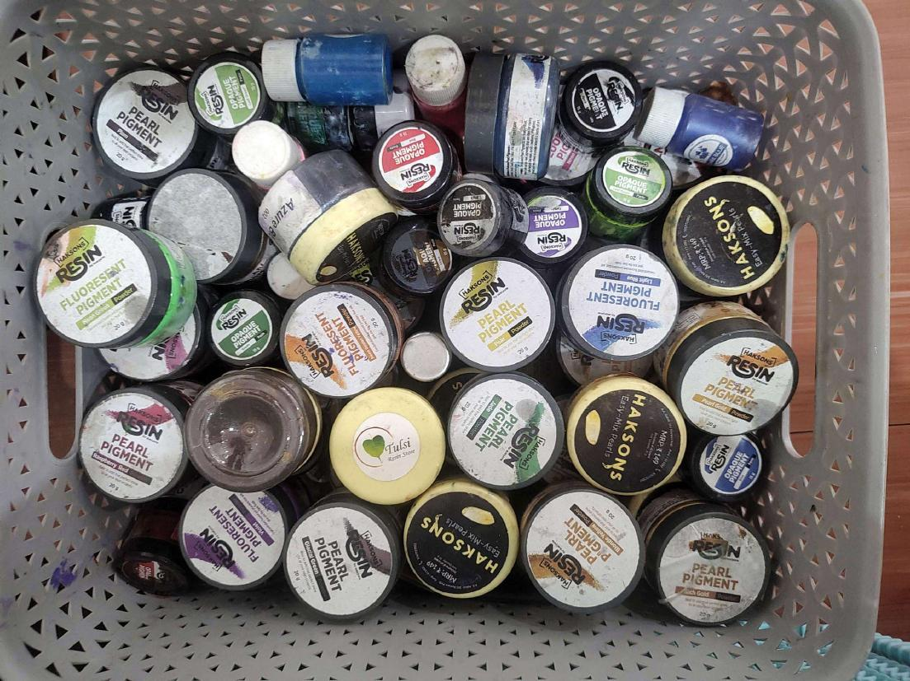

**metadata:** Located in Carton 1; price is a market-rate estimate, no exact listing found.

**uses:** Perfect for resin crafters making coasters, bookmarks, or jewellery, and for candle makers wanting a pearl shimmer in wax tablets, holographic candles, or metallic candle bowls.

## 2. Haksons Resin Opaque Pigment jars, 20g

**title:** Haksons Resin Opaque Pigment Jar — 20g, Solid Colour Finish

**description:** Highly concentrated opaque pigment for epoxy resin in a 20g jar — gives a fully solid, non-translucent colour pour. Unused surplus from our relocation, factory-sealed Haksons jars. Ideal for anyone wanting rich, saturated resin colour without hunting for individual tints.

**salePrice:** ₹135 per jar

**quantity:** 7 jars available

**image:** 

**metadata:** Located in Carton 1; price is a market-rate estimate, no exact listing found.

**uses:** Great for resin coasters, bookmarks and jewellery blanks where you want bold, opaque backgrounds, and equally usable for tinting matte jar candles or concrete candles to a solid shade.

## 3. Haksons Resin Fluorescent Pigment jars, 20g

**title:** Haksons Resin Fluorescent Pigment Jar — 20g, Neon Shades

**description:** Neon-bright fluorescent powder pigment for epoxy resin, giving a vivid glow under daylight (and UV, for some shades). Unused jars from our studio clear-out, sealed and ready to craft with. A fun, high-impact pigment that is hard to source at this price.

**salePrice:** ₹150 per jar

**quantity:** 4 jars available

**image:** 

**metadata:** Located in Carton 1; price is a market-rate estimate, no exact listing found.

**uses:** Perfect for statement resin bookmarks and jewellery, birthday glitter candles, and funky soap bars that need a loud neon pop.

## 4. Haksons Easy-Mix Pearls jars

**title:** Haksons Easy-Mix Pearls Jar — Pre-Dispersed Pearl Paste for Resin

**description:** Pre-dispersed pearl pigment paste that blends smoothly into epoxy resin without any clumping — much easier to work with than raw mica. Surplus unused stock from our relocation. A beginner-friendly way to get consistent, premium pearl effects in resin.

**salePrice:** ₹188 per jar

**quantity:** 2 jars available

**image:** 

**metadata:** Located in Carton 1; price is a market-rate estimate, no exact listing found.

**uses:** Ideal for resin coasters, bookmarks, and jewellery pieces where you want a swirled pearl finish, or for adding a professional shimmer layer to holographic and metallic candles.

## 5. Neon/unbranded mica pigment jars (various colors)

**title:** Neon Mica Pigment Jars — Mixed Colour Lot (Pink, Blue, Green, Yellow, Orange, Purple)

**description:** A bright multi-colour set of cosmetic/craft-grade mica pigment jars in neon shades — pink, blue, green, yellow, orange and purple. Surplus unused stock from our studio move, sealed jars. A low-cost way to stock an entire colour palette for soap, candle and resin work.

**salePrice:** ₹94 per jar

**quantity:** 16 jars available

**image:** 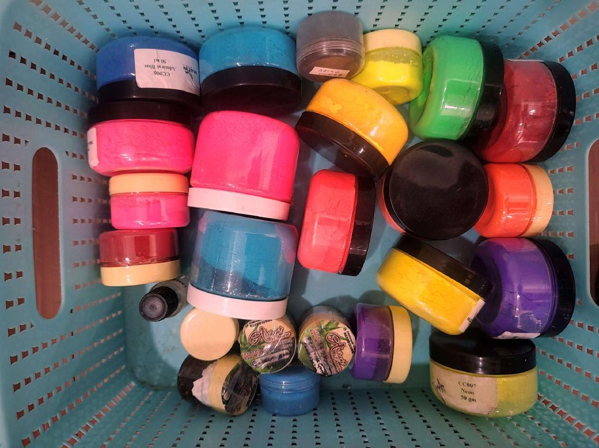

**metadata:** Located in Carton 1; priced against Flipkart listing.

**uses:** Great for colourful melt-and-pour soap bars, swirled wax tablets, birthday glitter candles, and bath bombs — essentially a starter palette for any small candle or soap maker.

## 6. CC-series mica jars (Admiral Blue, Neon, etc.)

**title:** CC-Series Branded Mica Pigment Jars — Named Shades (Admiral Blue, Neon etc.)

**description:** Branded cosmetic mica pigment jars from a candle/soap supplier line, each with a named colour shade such as Admiral Blue. Functionally equivalent to premium mica powders. Unused surplus from our relocation, sealed jars.

**salePrice:** ₹135 per jar

**quantity:** 16 jars available

**image:** 

**metadata:** Located in Carton 1; price is a market-rate estimate, no exact listing found.

**uses:** Perfect for colouring matte jar candles, concrete candles, and Le Collection-style frosted candles, or for shimmer soap bars and resin bookmarks.

## 7. Vedini Ayurveda Pure Essential Oil, 30ml (Bergamot, Geranium)

**title:** Vedini Ayurveda Pure Essential Oil — 30ml (Bergamot / Geranium)

**description:** Pure, undiluted ayurveda-brand essential oils in 30ml bottles — Bergamot (bright citrus-floral) and Geranium (sweet, rose-like floral). Unused surplus from our studio clear-out, sealed bottles. A good find for aromatherapy users and candle makers wanting real essential oils rather than fragrance blends.

**salePrice:** ₹150 per bottle

**quantity:** 2 bottles available

**image:** 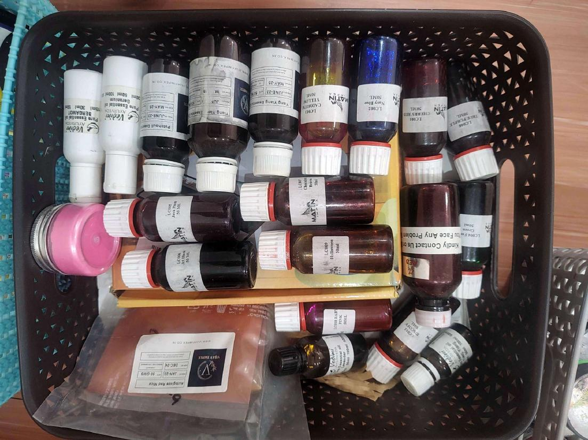

**metadata:** Located in Carton 1; price is a market-rate estimate, no exact listing found.

**uses:** Great for scenting soy jar candles, Feel Good or Love candles, melt-and-pour soap bars, and amber-jar aromatherapy candles.

## 8. Ylang Ylang Essential Oil, 50ml

**title:** Ylang Ylang Pure Essential Oil — 50ml Bottle

**description:** Sweet, floral essential oil distilled from Cananga odorata flowers, in a generous 50ml bottle. Sealed surplus stock from our relocation. A classic perfumery base note — buying 50ml at this price point is well below normal retail.

**salePrice:** ₹262 per bottle

**quantity:** 2 bottles available

**image:** 

**metadata:** Located in Carton 1; priced against Flipkart listing.

**uses:** Ideal for perfumed matte jar candles, Love candles, amber-jar candles, and luxurious melt-and-pour soap bars.

## 9. Patchouli Essential Oil

**title:** Patchouli Pure Essential Oil Bottle

**description:** Earthy, musky patchouli essential oil — a cult favourite perfumery base note. Unused, sealed bottle from our studio clear-out. Great for anyone who wants a deep, grounding scent for candles, soaps or blended oils.

**salePrice:** ₹112 per piece

**quantity:** 1 piece available

**image:** 

**metadata:** Located in Carton 1; priced against Flipkart listing.

**uses:** Perfect as a base note in dough bowl candles, Feel Good candles, triple-wick matki candles, and earthy artisan soap bars.

## 10. Matin candle dye bottles, 50ml (various colors)

**title:** Matin Impex Liquid Candle Dye — 50ml Bottles, Various Colours

**description:** 50ml bottles of highly concentrated oil-soluble liquid candle dye from Matin Impex, a well-known Indian candle-raw-materials brand. Unused surplus from our relocation. Each bottle tints many kilos of wax, so very cost-effective per candle.

**salePrice:** ₹112 per bottle

**quantity:** 4 bottles available

**image:** 

**metadata:** Located in Carton 1; price is a market-rate estimate, no exact listing found.

**uses:** Ideal for colouring soy or paraffin candles — matte jar candles, Love candles, Le Collection frosted candles, and holographic candles.

## 11. LC0xx-series candle dye bottles, 50ml (Chocolate Brown, Jet Black, Java Pink, Halloween, Baby Pink, etc.)

**title:** LC-Series Liquid Candle Dye — 50ml Bottles (Chocolate Brown, Jet Black, Java Pink, Halloween, Baby Pink etc.)

**description:** A named colour series of oil-soluble liquid candle dye in 50ml bottles — including Chocolate Brown, Jet Black, Java Pink, Halloween and Baby Pink. Unused surplus stock from our studio clear-out, factory-sealed. A single bottle colours a large batch of wax.

**salePrice:** ₹112 per bottle

**quantity:** 7 bottles available

**image:** 

**metadata:** Located in Carton 1; price is a market-rate estimate, no exact listing found.

**uses:** Perfect for tinting matte jar candles, birthday glitter candles, Love variants, and seasonal/themed candle SKUs.

## 12. Mica powder bag, "Aduigiare Red Mica", 50g

**title:** Aduigiare Red Mica Powder — 50g Pouch, Shimmery Red

**description:** A 50g resealable pouch of cosmetic-grade red mica pigment powder, giving a rich shimmery red finish. Sealed surplus from our relocation. 50g is a generous amount — enough for many batches of candles or soap.

**salePrice:** ₹112 per bag

**quantity:** 1 bag available

**image:** 

**metadata:** Located in Carton 1; priced against Flipkart listing.

**uses:** Great for red-themed Love candles, metallic candles, Valentine's or birthday glitter candle variants, resin bookmarks, and melt-and-pour soap bars.

## 13. Matin Impex Yellow Beeswax, 1kg

**title:** Matin Impex Natural Yellow Beeswax — 1kg Pack

**description:** Refined natural yellow beeswax from Matin Impex in a 1kg vacuum pouch — a staple raw material for natural candle-making, cosmetics, and lip balms. Unused, sealed stock from our studio relocation. Priced well below typical bulk rates.

**salePrice:** ₹488 per tin

**quantity:** 2 tins available

**image:** 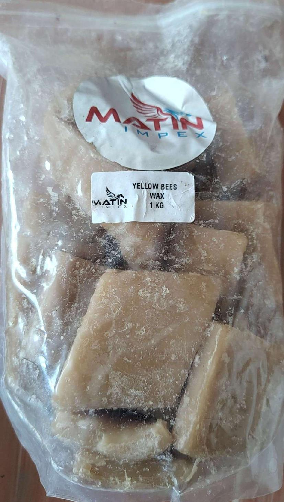

**metadata:** Located in Box 16AV; price is a market-rate estimate, no exact listing found.

**uses:** Perfect for natural pillar candles, dough bowl candles, mini candle urlis, DIY lip balms, and beeswax wraps.

## 14. Matin Impex Coconut Wax, ~5kg

**title:** Matin Impex Coconut Wax — ~5kg Bulk Bag

**description:** Premium plant-based coconut wax (often blended with soy) in a ~5kg bulk bag — makes clean-burning, smooth-topped scented candles. Unused surplus from our relocation, sealed sack. A substantial saving vs. standard wholesale 5kg rates.

**salePrice:** ₹1500 per tin

**quantity:** 1 tin available

**image:** 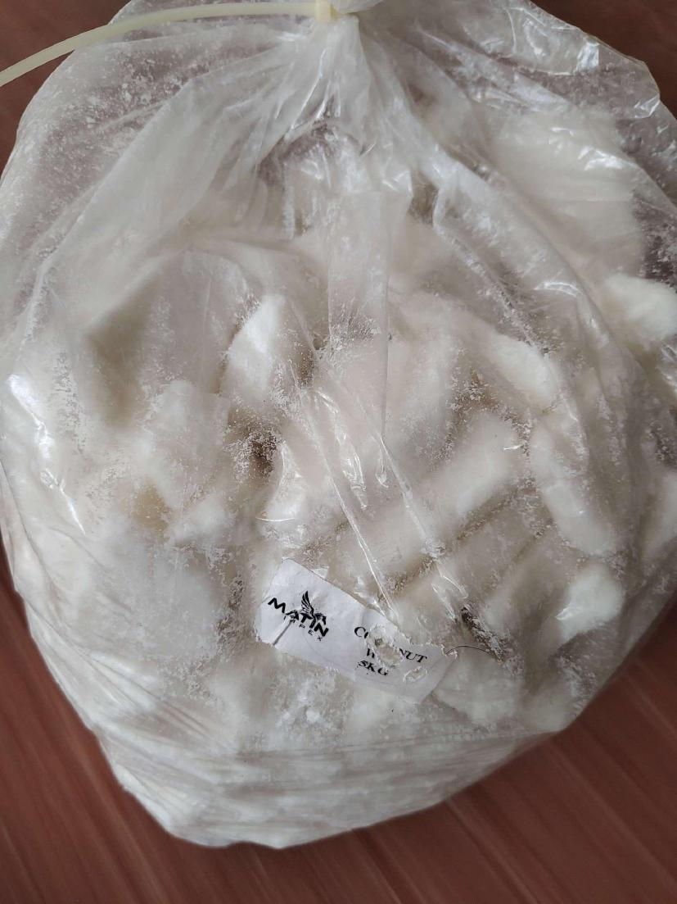

**metadata:** Located in Box 16AV; priced against Flipkart listing.

**uses:** Ideal wax base for amber jar candles, matte jar candles, Feel Good candles, Le Collection frosted candles, and dough bowl candles — effectively enough to pour 20-40 finished candles.

## 15. Vijay Impex Goat Milk Soap Base, 1kg

**title:** Vijay Impex Goat Milk Melt-and-Pour Soap Base — 1kg Block

**description:** A 1kg block of melt-and-pour soap base enriched with goat milk — moisturising, gentle on skin, and the easiest route into DIY soap. Sealed surplus from our studio clear-out. A great raw material for anyone running small-batch soap bars or gifting hampers.

**salePrice:** FREE — stock expired (Vijay Impex label prints "EXP DT: SEP-26"; past expiry as of today, offered free to clear)

**quantity:** 2 bags (1kg each) available

**image:** 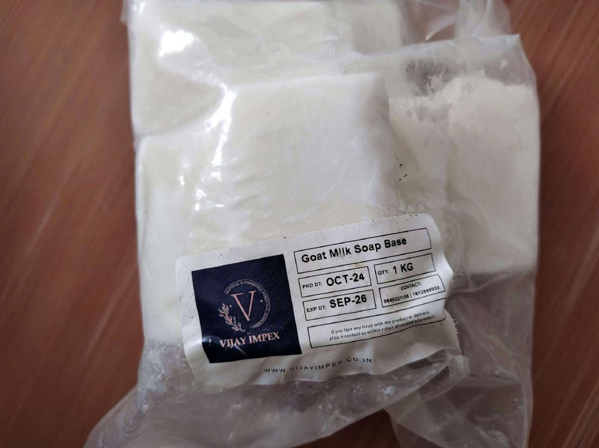

**metadata:** Located in Box 16AV; priced against Flipkart listing.

**uses:** Perfect raw material for handmade soap bars that can pair with the candle hampers, or stand-alone gifting soap sets — just melt, colour, scent, and pour.

## 16. Unlabeled white soap base/wax powder, ~1kg

**title:** White Melt-and-Pour Soap Base — ~1kg, Unbranded

**description:** A roughly 1kg bag of generic white (glycerine) melt-and-pour soap base in flake/powder form — the classic starting material for MP soap making. Clear-out stock from our relocation; no brand label but equivalent to standard white MP bases.

**salePrice:** ₹112 per piece

**quantity:** 1 piece available

**image:** 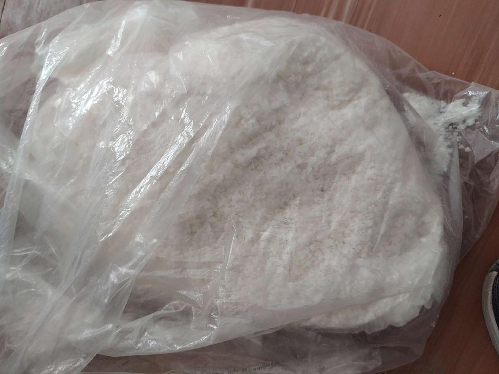

**metadata:** Located in Box 16AV; priced against Flipkart listing.

**uses:** Great base for coloured and scented MP soap bars — pair with the mica pigments and essential oils above for a full DIY soap project.

## 18. Metal candle wick sustainer tabs

**title:** Metal Candle Wick Sustainer Tabs — Bulk Pack

**description:** Small aluminium/metal discs that clip to the base of a candle wick to hold it upright and centred while pouring and burning. Bulk surplus stock from our studio relocation. An essential consumable for anyone making container candles at scale.

**salePrice:** ₹52 per piece

**quantity:** 50 pieces available

**image:** 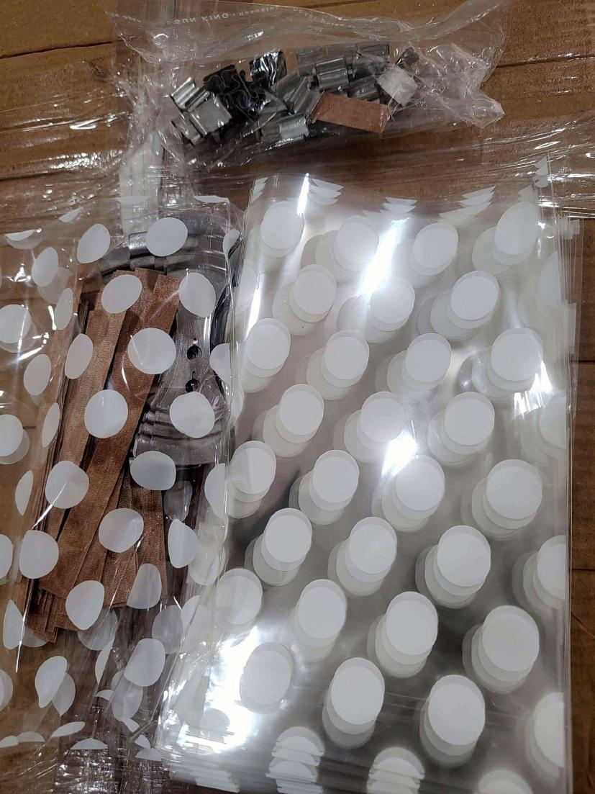

**metadata:** Located in Carton 3; priced against Flipkart listing.

**uses:** A core consumable for pouring amber jar candles, matte jar candles, Feel Good candles, Love candles, and any container candle in the hamper SKUs.

## 19. Pre-waxed cotton candle wicks

**title:** Pre-Waxed Cotton Candle Wicks — Bulk Pack

**description:** Cotton wicks pre-coated in wax so they stand straight and light cleanly — the standard wick type for container and pillar candles. Unused surplus from our relocation. Buying wicks in bulk like this is much cheaper than small retail packs.

**salePrice:** ₹60 per piece

**quantity:** 17 pieces available

**image:** 

**metadata:** Located in Carton 3; priced against Flipkart listing.

**uses:** The wick component for pouring amber jar candles, matte jar candles, holographic candles, dough bowl candles, and mini candle urlis.

## 20. White adhesive wick-stickers (sheets)

**title:** Heat-Resistant Candle Wick Stickers — Adhesive Dot Sheets

**description:** Full sheets of heat-resistant double-sided adhesive dots used to stick a wick sustainer tab to the base of a candle jar before pouring wax. Each sheet carries roughly 150-270 dots. Unused surplus from our studio relocation — far below retail per dot.

**salePrice:** ₹188 per sheet

**quantity:** 65 sheets available

**image:** 

**metadata:** Located in Carton 3; priced against Flipkart listing.

**uses:** The companion consumable for the wick tabs and wicks above — essential for pouring any container candle (amber jar, matte jar, Love, Feel Good, Le Collection).

## 22. Paraffin stand, metal, 19.5x11cm

**title:** Metal Paraffin / Wax Melting Stand — 19.5 x 11 cm

**description:** A small rectangular metal stand/trivet, roughly 19.5 x 11 cm, used to raise a wax pot or paraffin block off the stove or table during melting. Gives even heat distribution and prevents scorching work surfaces. Surplus from our relocation.

**salePrice:** ₹262 per piece

**quantity:** 1 (sold as a single lot) piece available

**image:** 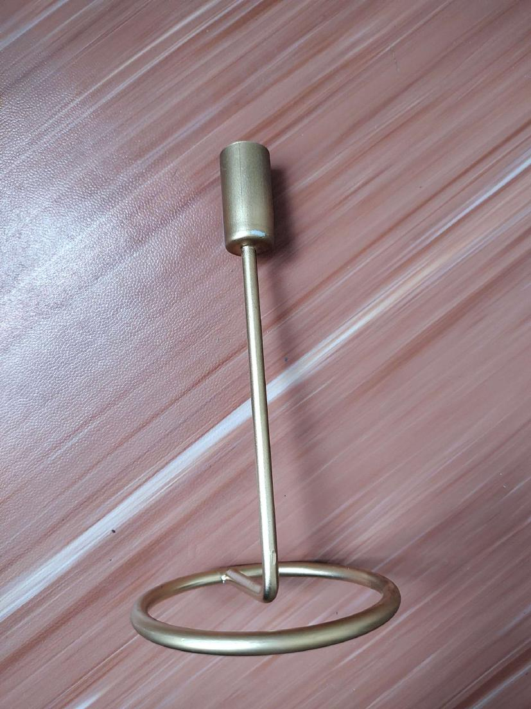

**metadata:** Carton location unclear; price is a market-rate estimate, no exact listing found.

**uses:** A working-studio tool for anyone pouring candles at home — useful during wax melts for amber jar candles, matte jar candles, and any container or pillar pour.

## 23. Glass candle jars / votive holders, bubble-wrapped (assorted)

**title:** Assorted Clear Glass Candle Jars / Votive Holders — Bubble-Wrapped Lot

**description:** Plain clear-glass cylindrical/votive jars (typically 100-250ml) individually bubble-wrapped and ready to pour. Unused surplus candle vessels from our studio relocation. Great bulk pricing for small candle businesses or hobbyists.

**salePrice:** ₹71 per jar

**quantity:** 47 jars available

**image:** 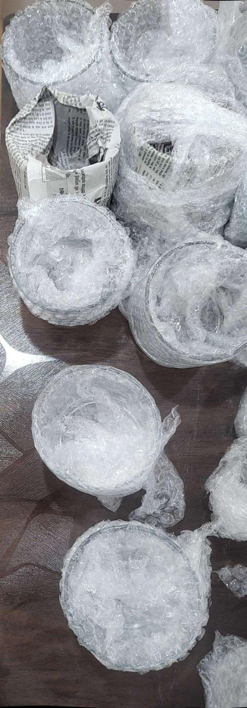

**metadata:** Located in Box 10 / Box 12AV / Carton 1 / Carton 4; price is a market-rate estimate, no exact listing found.

**uses:** The vessel for amber jar candles, matte jar candles, holographic candles, Feel Good candles, and the Illuminate/Enhance gift hamper SKUs — essentially the core container for most Flipkart-style candle pours.

## 24. Glass candle jars w/ wooden press-fit lids (smoked rim)

**title:** Scandi-Style Glass Candle Jars with Wooden Press-Fit Lids — Smoked Rim

**description:** Premium candle-vessel sets — tinted/smoked-rim glass jars paired with a flat wooden disc that press-fits into the rim as a lid. The classic Scandinavian candle format. Unused, carton-packed surplus from our relocation.

**salePrice:** ₹188 per jar

**quantity:** 7 jars available

**image:** 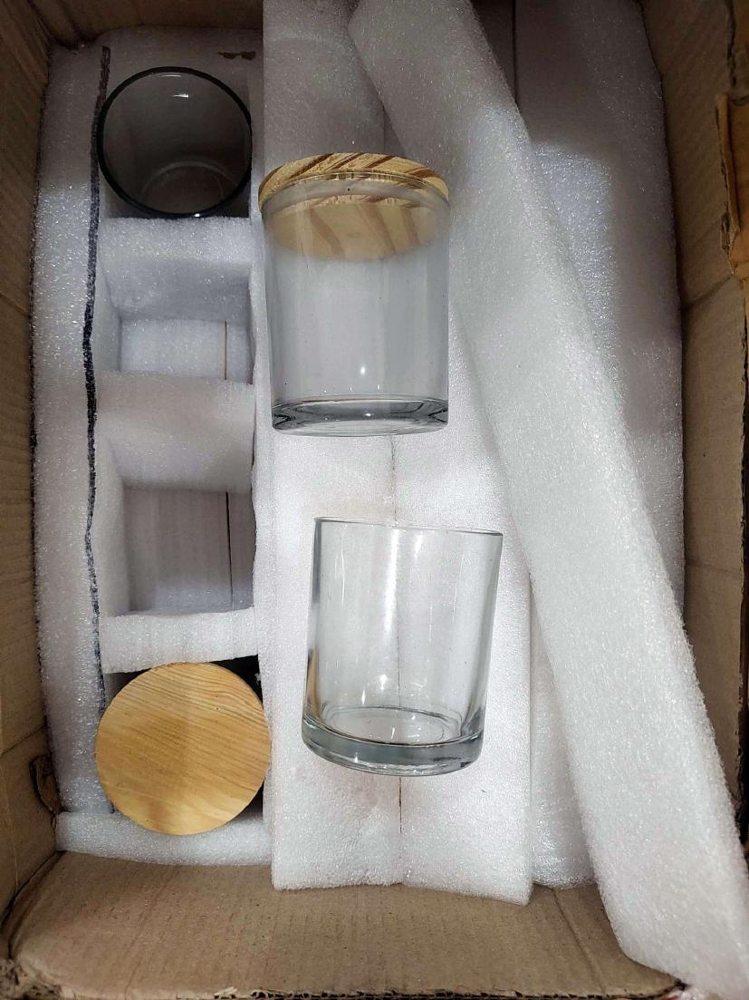

**metadata:** Located in Box 12AV; price is a market-rate estimate, no exact listing found.

**uses:** Perfect finished vessel for matte jar candles, Feel Good candles, Love candle variants, or ready-to-gift candle hampers like Illuminate 1 & 2 and Enhance.

## 25. Gold/brass metal candle jar lids

**title:** Gold / Brass-Finish Metal Candle Jar Lids

**description:** Press-fit or screw-on metal lids in a brushed or polished gold / brass finish, sized to match standard candle-jar rims (typically 70mm or 85mm). Unused surplus from our studio clear-out. Instantly upgrades any plain candle jar.

**salePrice:** ₹90 per jar

**quantity:** 8 jars available

**image:** 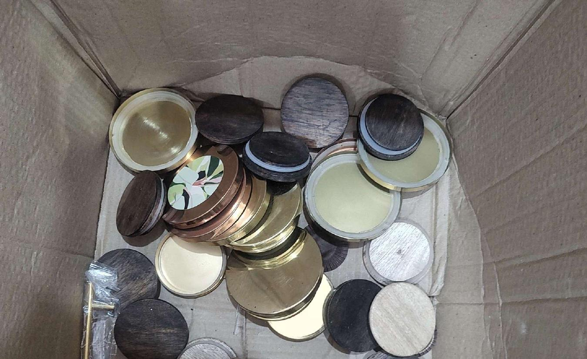

**metadata:** Located in Carton 1; price is a market-rate estimate, no exact listing found.

**uses:** Ideal lid for gold-themed matte jar candles, birthday glitter candles, metallic candles, and premium gift hampers like Illuminate or Enhance.

## 26. Copper/rose-gold metal candle lids

**title:** Copper / Rose-Gold Metal Candle Jar Lids

**description:** Press-fit metal candle lids in a copper or rose-gold electroplated finish, sized for standard candle-jar rims. Unused surplus from our relocation. Great for matched-finish gifting SKUs.

**salePrice:** ₹101 per lid

**quantity:** 3 lids available

**image:** 

**metadata:** Located in Carton 1; price is a market-rate estimate, no exact listing found.

**uses:** Perfect lid for rose-gold / copper-themed candle hampers, metallic candles, and Love candle variants.

## 27. Dark-stained wooden candle lids

**title:** Dark Walnut-Stained Wooden Candle Jar Lids

**description:** Flat circular MDF/pine discs with a dark walnut / espresso stain, designed to press-fit into a glass candle jar rim. Unused surplus from our studio clear-out. A warm, premium finish.

**salePrice:** ₹60 per lid

**quantity:** 12 lids available

**image:** 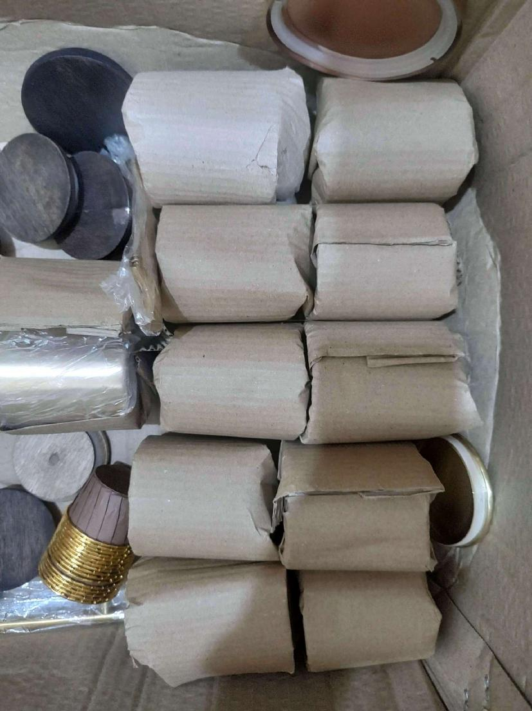

**metadata:** Located in Carton 1; price is a market-rate estimate, no exact listing found.

**uses:** Pairs naturally with matte jar candles, amber jar candles, Feel Good candles, and rustic dough bowl candle-style hampers.

## 28. Light natural wooden candle lids

**title:** Natural Pale Wood Candle Jar Lids — Laser-Engraving-Ready

**description:** Flat circular wooden discs in a pale pine/beech-look finish, designed to press-fit into a glass candle jar rim. Great blank surface for branding or laser-engraving. Unused surplus from our relocation.

**salePrice:** ₹60 per lid

**quantity:** 3 lids available

**image:** 

**metadata:** Located in Carton 1; price is a market-rate estimate, no exact listing found.

**uses:** Ideal lid for amber jar candles, matte jar candles, and personalised/engraved gift hamper variants.

## 29. Silver/pewter metal candle lids

**title:** Silver / Pewter-Finish Metal Candle Jar Lids

**description:** Brushed silver / pewter press-fit metal candle lids, sized for standard jar rims. The least common of the metal-lid finishes, so a nice stock-up opportunity. Unused surplus from our studio move.

**salePrice:** ₹90 per lid

**quantity:** 2 lids available

**image:** 

**metadata:** Located in Carton 1; price is a market-rate estimate, no exact listing found.

**uses:** Perfect lid for silver-themed metallic candles, holographic candles, and modern monochrome gift hampers.

## 30. Black matte glass candle jar, gold rim

**title:** Matte Black Glass Candle Vessel with Gold Rim

**description:** A single statement candle vessel — opaque matte-black glass with a thin hand-painted gold rim detail. Unused, from our premium-gifting line surplus. The kind of vessel usually reserved for luxury gifting SKUs.

**salePrice:** ₹319 per jar

**quantity:** 1 jar available

**image:** 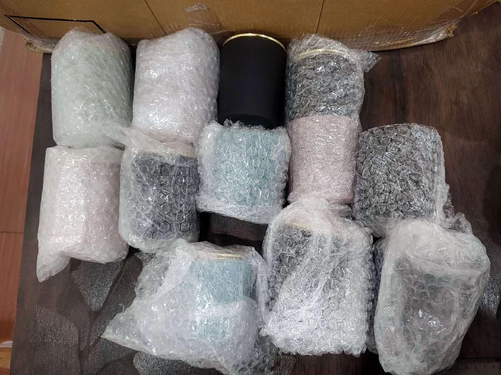

**metadata:** Located in Carton 1; price is a market-rate estimate, no exact listing found.

**uses:** A premium vessel for pouring a one-off Love candle, metallic candle or a centrepiece candle in an Illuminate / Enhance-style gift hamper.

## 31. Terracotta/clay candle vessel, cream rim

**title:** Handmade Terracotta Candle Vessel — Cream-Glazed Rim

**description:** A handmade earthenware pot (likely Indian pottery) with a glazed cream band near the top — a rustic, organic candle vessel with real character. Unused surplus from our studio clear-out.

**salePrice:** ₹206 per piece

**quantity:** 1 piece available

**image:** 

**metadata:** Located in Carton 1; price is a market-rate estimate, no exact listing found.

**uses:** Perfect vessel for a rustic dough bowl-style candle, a mini candle urli, or a concrete-candle-adjacent earthy SKU.

## 32. Smoked grey glass pedestal/goblet candle vessel

**title:** Smoked Grey Glass Pedestal / Goblet Candle Vessel

**description:** A footed goblet-shaped glass vessel in a smoked grey tint — holds a pillar or container candle for a chalice-style presentation. A sizable decorative piece. Unused, carton-packed surplus from our relocation.

**salePrice:** ₹319 per piece

**quantity:** 1 piece available

**image:** 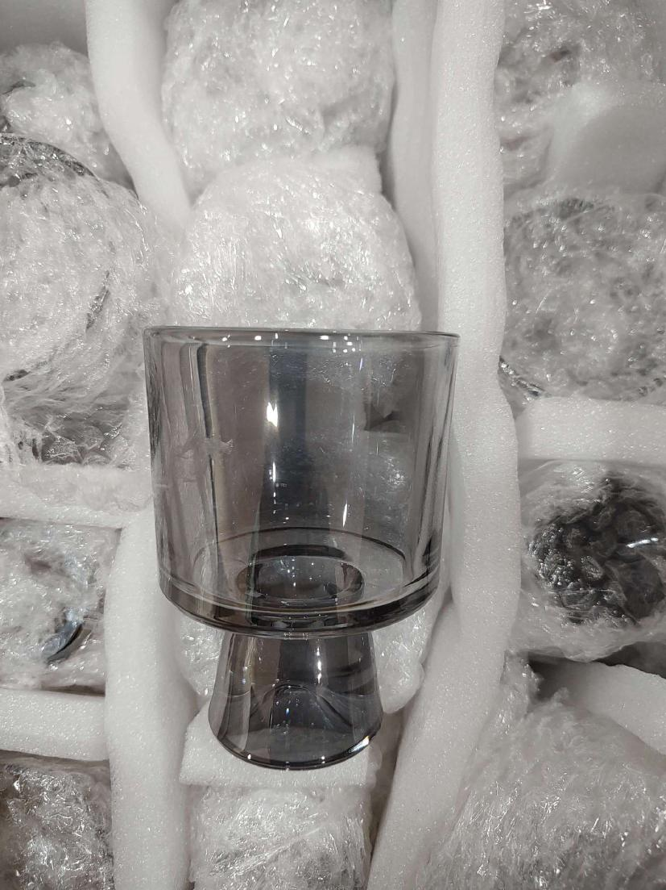

**metadata:** Located in Box 10; price is a market-rate estimate, no exact listing found.

**uses:** A premium standalone vessel for a holographic candle, triple-wick holographic matki-style candle, or centrepiece candle in a Vertical Bliss / Illuminate gift hamper.

## 33. Glossy black cylindrical glass candle jar + gold screw lid

**title:** Premium Black Glass Candle Jar with Gold Screw Lid

**description:** A sleek cylindrical black glass candle jar paired with a gold-toned metal screw lid, the kind of vessel used for premium container candles. Surplus unused stock from our relocation, in clean ready-to-fill condition. Ideal for anyone pouring their own luxury candles or needing a smart finished vessel.

**salePrice:** ₹356 per jar

**quantity:** 1 jar available

**image:** 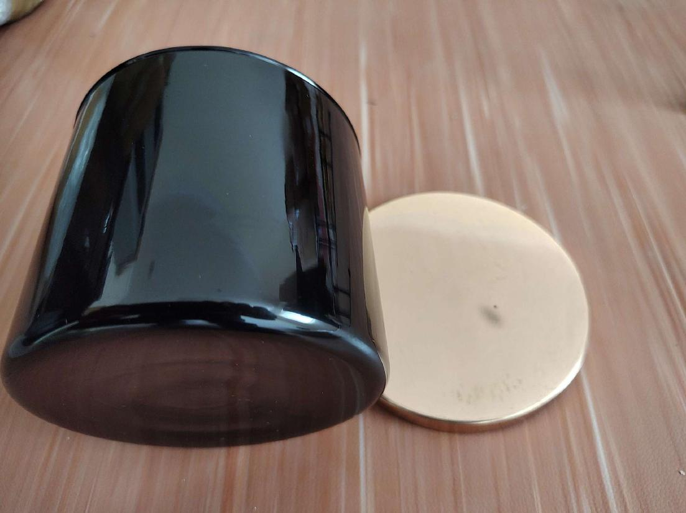

**metadata:** Stored in Box 15AV; price is a market-rate estimate, no exact listing found.

**uses:** Pour your own soy wax to make a premium matte-black container candle in the style of our Flipkart matte jar candle or amber jar candle — the gold lid doubles as a snuff-friendly closure for gifting.

## 34. Gold-sprayed small glass bottles (roll-on / mini size)

**title:** Gold-Finish Mini Glass Bottles (Roll-on / Attar Size)

**description:** Small 10–30 ml glass bottles with a metallic gold spray finish, originally intended for perfume, attar, or essential-oil packaging. Surplus unused inventory from our relocation, still packed in their original dividers. A ready-made premium look for anyone bottling fragrances or creating mini decor.

**salePrice:** ₹39 per bottle

**quantity:** 25 bottles available

**image:** 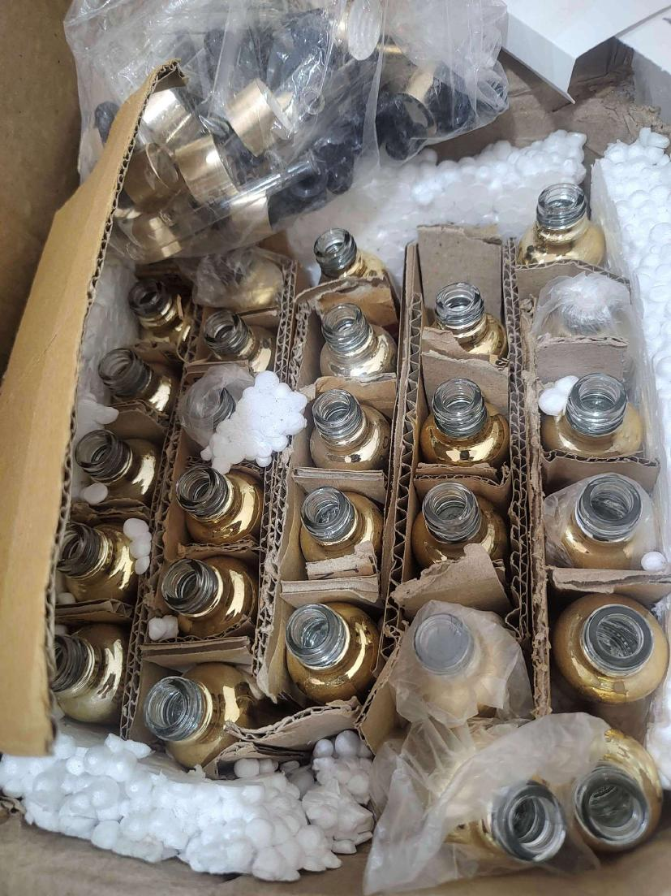

**metadata:** Packed in Carton 1; price is a market-rate estimate, no exact listing found.

**uses:** Perfect for bottling fragrance oils, attars, or roll-on perfumes to sell alongside candle hampers; could also feature as mini vases inside a decorative gift hamper.

## 35. Black plastic bottle caps / pump tops (bag)

**title:** Black Plastic Caps & Pump Tops — Perfume/Attar Fit

**description:** A mixed bag of black plastic closures — plain screw caps and spray/pump tops — sized to fit small 10–30 ml roll-on and perfume bottles. Surplus unused stock from our relocation, ready to pair with bottles you already have. Handy whether you’re bottling scents or restocking craft supplies.

**salePrice:** ₹14 per bottle

**quantity:** 1 bottle available

**image:** 

**metadata:** Packed in Carton 1; price is a market-rate estimate, no exact listing found.

**uses:** Pair directly with the gold mini glass bottles (Item 34) to finish a complete attar/roll-on/perfume packaging kit for a fragrance line or gift hamper add-on.

## 36. Gold/brass metal candlestick holders (ring base, cylindrical cup)

**title:** Gold/Brass Taper Candle Holders (Set, Ring Base)

**description:** Elegant gold/brass-finished taper candle holders with a thin stem and ring base — the classic tablescape style for a dinner or event setup. Multiple matching pieces, surplus unused from our relocation and still partially in their factory plastic. A ready-to-use decor set.

**salePrice:** ₹262 per piece

**quantity:** 6 pieces available

**image:** 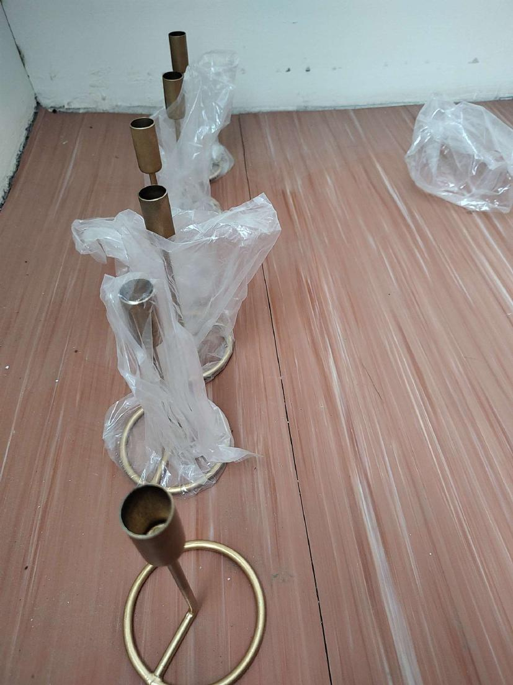

**metadata:** Stored in Box 18AV; price is a market-rate estimate, no exact listing found.

**uses:** Sell as-is as a dining or wedding decor set, or pair with your own taper candles to build a premium tablescape gifting bundle alongside our candle hampers.

## 37. Silicone faceted geometric heart mould, large single-cavity

**title:** Large 3D Faceted Heart Silicone Mould

**description:** A flexible silicone mould that casts one large low-poly, faceted 3D heart — a popular shape for pillar candles, decorative soap bars, or resin art. Surplus unused stock from our relocation, in clean ready-to-pour condition. A high-impact form with strong visual appeal.

**salePrice:** ₹488 per mould

**quantity:** 1 mould available

**image:** 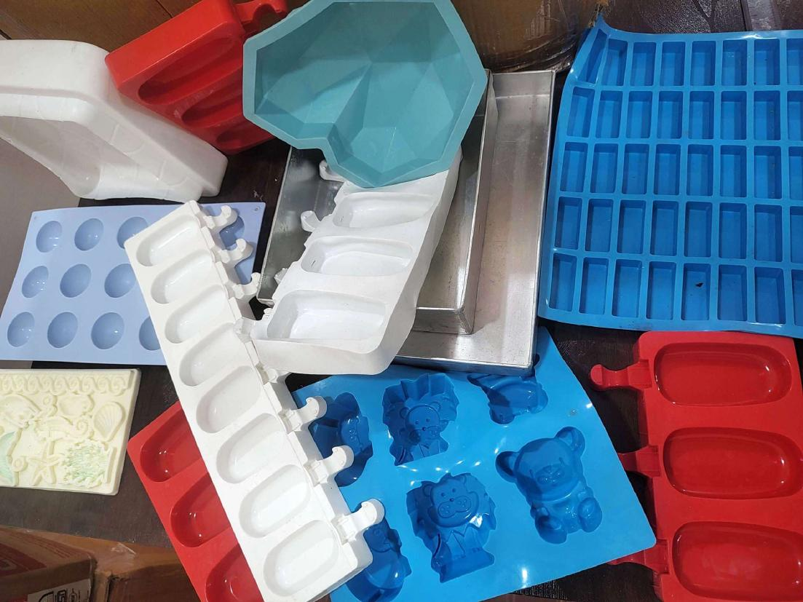

**metadata:** Packed in Carton 4; price is a market-rate estimate, no exact listing found.

**uses:** Pour soy wax to produce statement 3D heart pillar candles for Valentine's/wedding gifting, or use it to cast large geometric soaps and resin paperweights.

## 38. White plastic popsicle / cakesicle mould, multi-cavity

**title:** White Plastic Cakesicle / Popsicle Mould Tray

**description:** A rigid white plastic tray with popsicle-shaped cavities and stick slots, built for cakesicles, ice pops, or novelty candle/soap shapes. Surplus unused tray from our relocation, in clean ready-to-use condition. A versatile mould for bakery or craft makers.

**salePrice:** ₹206 per mould

**quantity:** 3 moulds available

**image:** 

**metadata:** Packed in Carton 4; price is a market-rate estimate, no exact listing found.

**uses:** Use with wax and a wick to pour cakesicle-style novelty candles, or cast layered soaps/chocolate pops — a fun crafting format for gifting line add-ons.

## 39. Red plastic popsicle / cakesicle mould

**title:** Red Plastic Cakesicle / Popsicle Mould Tray

**description:** A rigid red plastic popsicle-tray mould — the same working format as our white one, with multiple popsicle-shaped cavities and stick slots. Surplus unused from our relocation, clean and ready to pour. Great for cakesicles, ice pops, or craft candles.

**salePrice:** ₹206 per mould

**quantity:** 2 moulds available

**image:** 

**metadata:** Packed in Carton 4; price is a market-rate estimate, no exact listing found.

**uses:** Pair with the white tray (Item 38) for a two-colour cakesicle production set, or cast novelty wax melts/popsicle candles on a stick for seasonal gifting.

## 40. Blue silicone rectangular soap-bar mould (~40 cavities)

**title:** 40-Cavity Rectangular Soap/Wax-Tablet Silicone Mat

**description:** A large flat blue silicone mat with roughly 40 small rectangular cavities, perfect for small guest soaps, wax melts, or chocolate bars. Surplus unused stock from our relocation, in clean ready-to-pour condition. Bulk production in one pour.

**salePrice:** ₹469 per mould

**quantity:** 1 mould available

**image:** 

**metadata:** Packed in Carton 4; price is a market-rate estimate, no exact listing found.

**uses:** Ideal for casting our signature wax tablets (both the pack-of-3 and pack-of-1 SKUs) in bulk, or for running batches of guest-size soap bars in a single pour.

## 41. Light-blue silicone mini-dome mould (12 cavities)

**title:** 12-Cavity Mini-Dome Silicone Mould

**description:** A food-grade light-blue silicone tray with 12 small half-sphere cavities for pouring wax, chocolate, soap, resin, or bath bombs into neat dome shapes. Surplus unused from our relocation, in clean ready-to-use condition. A go-to shape for embeds and add-ons.

**salePrice:** ₹150 per mould

**quantity:** 1 mould available

**image:** 

**metadata:** Packed in Carton 4; priced against Flipkart listing.

**uses:** Perfect for making wax melt domes or chocolate-style dome tablets, or to pour small wax embeds that sit on top of our amber jar, matte jar, or metallic bowl candles.

## 42. Blue silicone animal-shape mould (lion/bear, ~4 cavities)

**title:** Animal-Shape Silicone Soap Mould (Lion/Bear)

**description:** A silicone mould with cute animal-face cavities (lion, bear, hippo and similar), the classic format for kids' handmade soaps. Surplus unused from our relocation, in clean pourable condition. A playful add-on for anyone running a soap or kids' gifting line.

**salePrice:** ₹188 per mould

**quantity:** 1 mould available

**image:** 

**metadata:** Packed in Carton 4; priced against Flipkart listing.

**uses:** Cast kids' novelty soaps or chocolate pieces for birthday hampers, or pour mini wax-melt animal embeds to pair with our wax tablet line.

## 43. Silicone urn/vase hollow candle mould

**title:** Decorative Urn/Vase Hollow Silicone Candle Mould

**description:** A specialty silicone mould shaped like a decorative urn/vase, designed for pouring statement pillar candles in that ornamental form. Surplus unused from our relocation, in clean ready-to-pour condition. Produces a high-end sculptural candle in one pour.

**salePrice:** ₹488 per mould

**quantity:** 1 mould available

**image:** 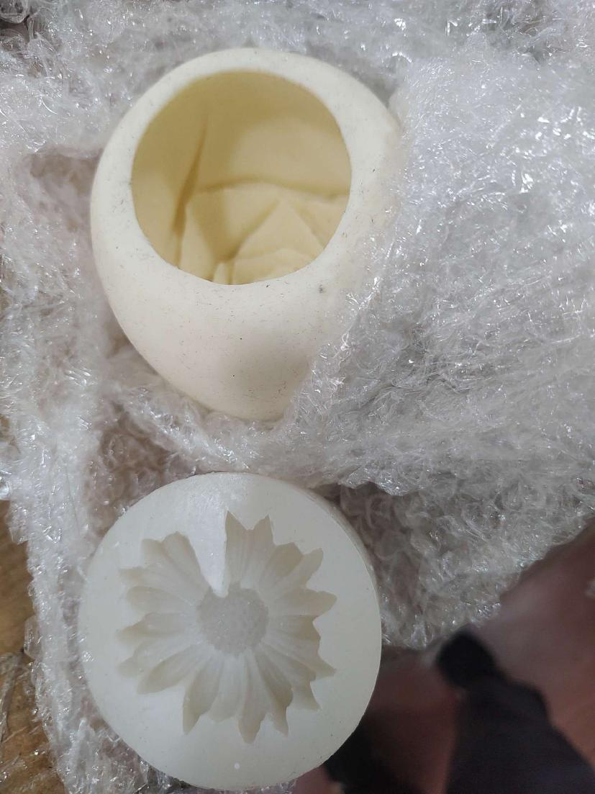

**metadata:** Packed in Carton 1; price is a market-rate estimate, no exact listing found.

**uses:** Use with soy or paraffin wax to pour a free-standing urn-style pillar candle — a decorative cousin to our mini candle urli and dough bowl candle ranges.

## 44. Silicone sunflower/daisy candle mould

**title:** Sunflower / Daisy Silicone Candle Mould

**description:** A flat silicone mould shaped like a sunflower or daisy bloom, perfect for decorative pillar or chunk candles. Surplus unused from our relocation, in clean ready-to-pour condition. A charming floral form that reads well on a gift hamper.

**salePrice:** ₹199 per mould

**quantity:** 1 mould available

**image:** 

**metadata:** Packed in Carton 1; priced against Flipkart listing.

**uses:** Pour decorative floral pillar candles that can anchor a candle hamper (think "Illuminate" or "Enhance" style gift bundles), or cast floral embeds to top metallic/matte jar candles.

## 45. Brown silicone multi-cavity heart mould (~15 cavities)

**title:** 15-Cavity Mini Heart Silicone Mould

**description:** A large brown silicone mat with roughly 15 small heart cavities — ideal for small embeds, chocolate bites, soap tiles, and wax melts. Surplus unused from our relocation, in clean ready-to-pour condition. One pour yields a tray of hearts.

**salePrice:** ₹124 per mould

**quantity:** 1 mould available

**image:** 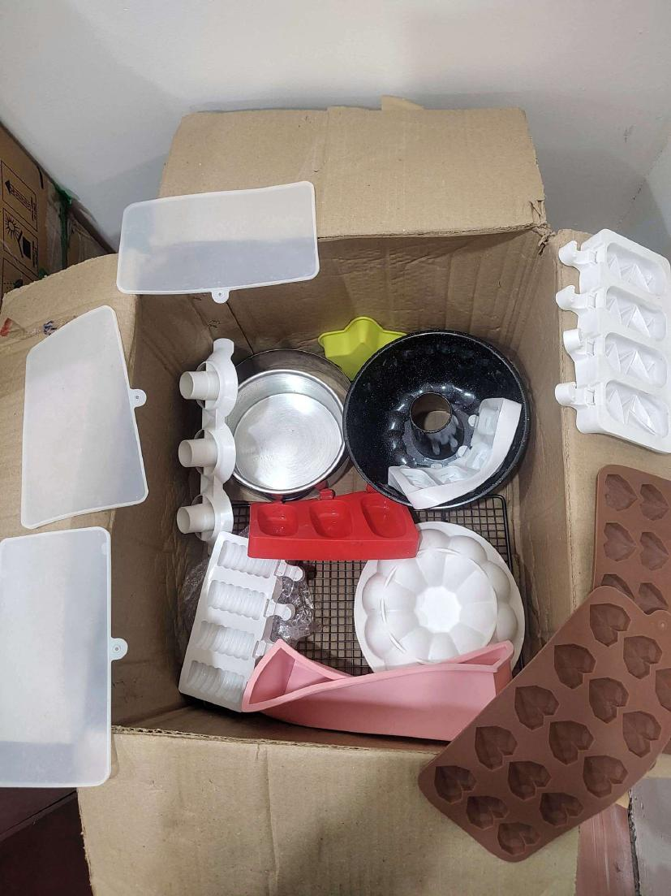

**metadata:** Packed in Carton 4; priced against Flipkart listing.

**uses:** Perfect for mini heart wax melts similar to our wax tablet range (Valentine's edition), heart soap favours, or embed hearts to decorate the tops of our love-themed candles.

## 46. White multi-cavity silicone mould (~15 small cavities)

**title:** 15-Cavity White Silicone Multi-Mould

**description:** A general-purpose white silicone tray with around 15 small cavities — a workhorse for small embeds, chocolates, soap bites, and wax melts. Surplus unused from our relocation, in clean ready-to-pour condition. Useful format for bulk production.

**salePrice:** ₹124 per mould

**quantity:** 1 mould available

**image:** 

**metadata:** Packed in Carton 4; priced against Flipkart listing.

**uses:** Cast batches of small wax melt bites (pairing with our Wax Tablets SKU), mini chocolates for gifting hampers, or soap embeds for layered artisanal bars.

## 47. Red silicone 3-cavity rectangular mould

**title:** 3-Cavity Rectangular Silicone Soap-Bar Mould

**description:** A red silicone mould with 3 rectangular cavities, each the size of a standard soap bar or chocolate slab. Surplus unused from our relocation, in clean ready-to-pour condition. Reliable everyday format for bar production.

**salePrice:** ₹188 per mould

**quantity:** 1 mould available

**image:** 

**metadata:** Packed in Carton 4; priced against Flipkart listing.

**uses:** Pour standard soap bars or chocolate slabs three at a time, or cast large rectangular wax melts/bars for a seasonal edit of our wax tablet range.

## 48. Yellow silicone star mould

**title:** Yellow Silicone Star Mould

**description:** A yellow silicone star-shaped mould for soap, candle, chocolate, or fondant stars. Surplus unused from our relocation, in clean ready-to-pour condition. A festive, cheerful form for seasonal gifting.

**salePrice:** ₹154 per mould

**quantity:** 1 mould available

**image:** 

**metadata:** Packed in Carton 4; priced against Flipkart listing.

**uses:** Perfect for Christmas/Diwali star-shaped wax melts, decorative soaps, or chocolate tops to garnish our birthday glitter candle and gift hamper offerings.

## 49. Silicone numerals mould (0-9)

**title:** Silicone Numerals (0–9) Mould — Sealed Pack

**description:** A 10-cavity silicone mould casting digits 0 through 9 — great for fondant toppers, soap numerals, candle numbers, and resin crafts. Surplus unused stock from our relocation, still sealed in its original packaging. Instant personalisation for birthdays and anniversaries.

**salePrice:** ₹139 per mould

**quantity:** 1 mould available

**image:** 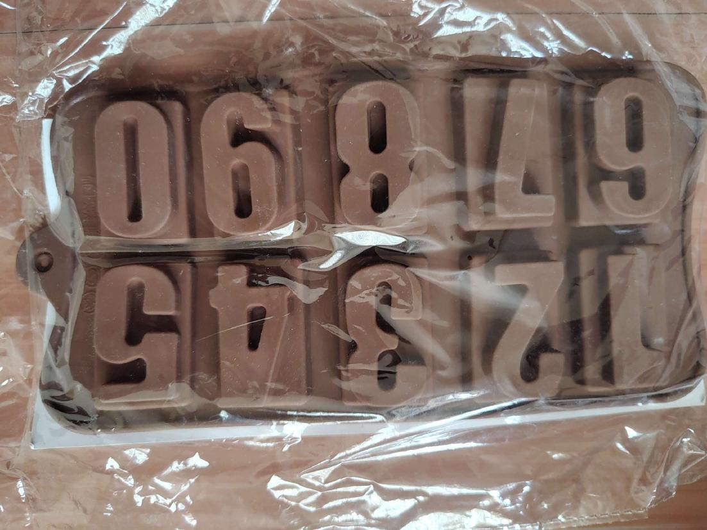

**metadata:** Stored in Box 12AV; priced against Flipkart listing.

**uses:** Cast wax or chocolate numerals to personalise our birthday glitter candle hampers or add age-number toppers to custom bakes and candles.

## 50. Grey silicone hexagon/honeycomb-bee mould (6 cavities)

**title:** Honeycomb + Bee Silicone Mould (6 Cavities)

**description:** A grey silicone mould with 6 hexagonal honeycomb cavities featuring a bee motif at the centre — ideal for honey/bee themed soaps, candles, and chocolates. Surplus unused from our relocation, in clean ready-to-pour condition. A charming nature-inspired form.

**salePrice:** ₹218 per mould

**quantity:** 1 mould available

**image:** 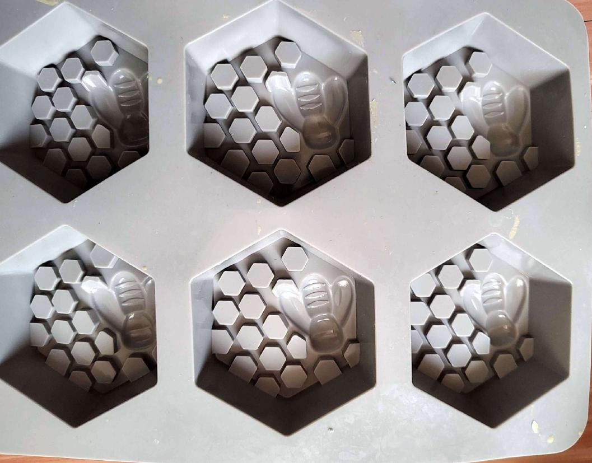

**metadata:** Stored in Box 12AV; priced against Flipkart listing.

**uses:** Pour beeswax honeycomb-style wax melts (a natural fit with our wax tablet line) or create bee-themed artisanal soaps for springtime gifting.

## 51. Blue silicone fluted round tart mould

**title:** Fluted Round Silicone Tart Mould

**description:** A single blue silicone mould shaped like a fluted mini-tart/quiche ring — equally handy for baking and for casting tart-shaped soap, candle, or fondant pieces. Surplus unused from our relocation, in clean ready-to-use condition.

**salePrice:** ₹150 per mould

**quantity:** 1 mould available

**image:** 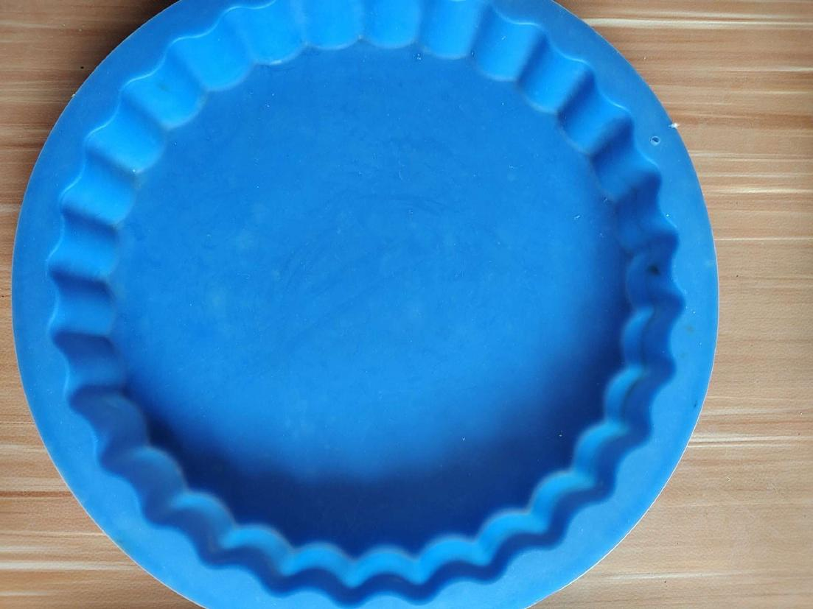

**metadata:** Stored in Box 12AV; priced against Flipkart listing.

**uses:** Cast a pretty fluted-edge candle resembling a mini tart (a cousin of our dough bowl and metallic bowl candles), or pour patisserie-style soaps for a bakery-inspired gift line.

## 52. Brown silicone chocolate-bar mould (6 cavities)

**title:** 6-Cavity Silicone Chocolate / Wax-Melt Bar Mould

**description:** A brown silicone chocolate-bar mould with 6 break-apart bar cavities and one segmented bar section. Surplus unused stock from our relocation, still sealed in its clear plastic wrap. Works equally well for wax melts and soap bars.

**salePrice:** ₹140 per mould

**quantity:** 1 mould available

**image:** 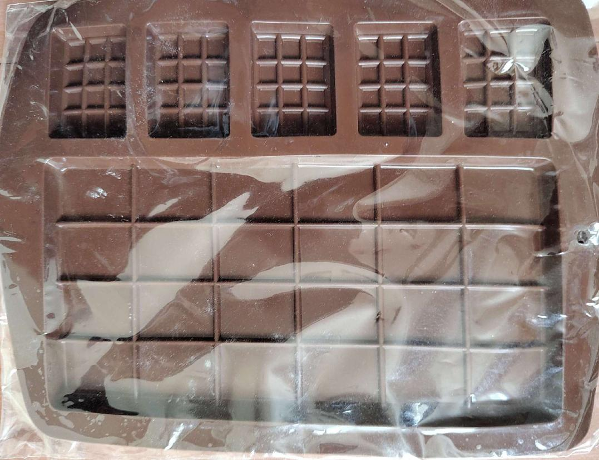

**metadata:** Stored in Box 12AV; priced against Flipkart listing.

**uses:** Ideal for pouring snap-off wax melt bars in the style of our wax tablet SKU, or for casting small guest soap bars and chocolate bars for gift hampers.

## 53. Mint-green silicone 6-cavity mould (flower/butterfly/ladybug)

**title:** Garden-Theme Silicone Mould (Flower/Butterfly/Ladybug, 6 Cavities)

**description:** A mint-green silicone 6-cavity mould with mixed garden shapes — flowers, butterflies, and ladybugs. Surplus unused from our relocation, in clean ready-to-pour condition. A fun format for kids' and springtime gifting.

**salePrice:** ₹139 per mould

**quantity:** 1 mould available

**image:** 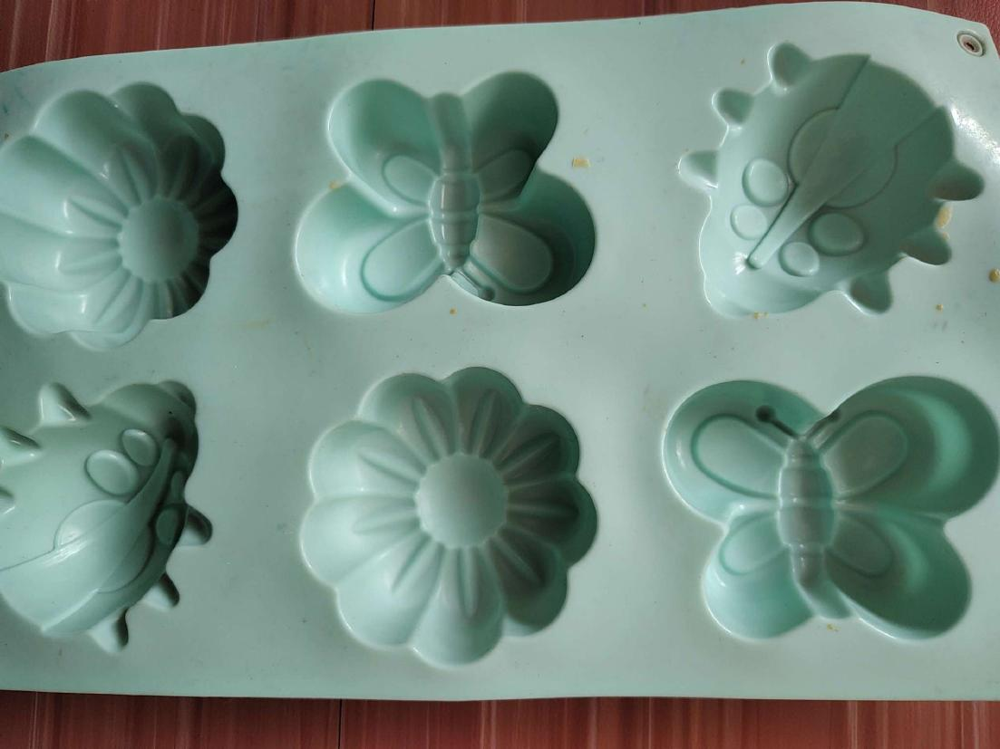

**metadata:** Stored in Box 12AV; priced against Flipkart listing.

**uses:** Cast colourful wax melt embeds to garnish our amber jar or matte jar candles, or produce novelty soaps and chocolates for kids' birthday hampers.

## 54. Lilac silicone 6-cavity 3D geometric heart mould

**title:** 3D Geometric Heart Silicone Mould (6 Cavities)

**description:** A pale lilac silicone mould with six 3D faceted geometric heart cavities — a popular shape for decorative soaps and mousse/chocolate hearts. Surplus unused from our relocation, in clean ready-to-pour condition. Trend-forward form for gifting.

**salePrice:** ₹128 per mould

**quantity:** 1 mould available

**image:** 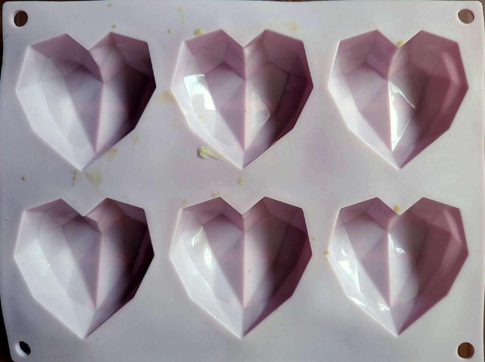

**metadata:** Stored in Box 12AV; priced against Flipkart listing.

**uses:** Perfect for producing a batch of faceted heart wax melts (sibling to our wax tablet range) or heart-shaped artisanal soaps for Valentine's and love-themed candle hampers.

## 55. Purple silicone 4-cavity swirl-pattern square mould

**title:** 4-Cavity Swirl-Pattern Square Silicone Mould

**description:** A purple silicone mould with four generous square cavities, each with a textured swirl/wave pattern on the base — the kind of ornamental finish prized on artisanal soap bars and mousse cakes. Surplus unused from our relocation, in clean ready-to-pour condition.

**salePrice:** ₹161 per mould

**quantity:** 1 mould available

**image:** 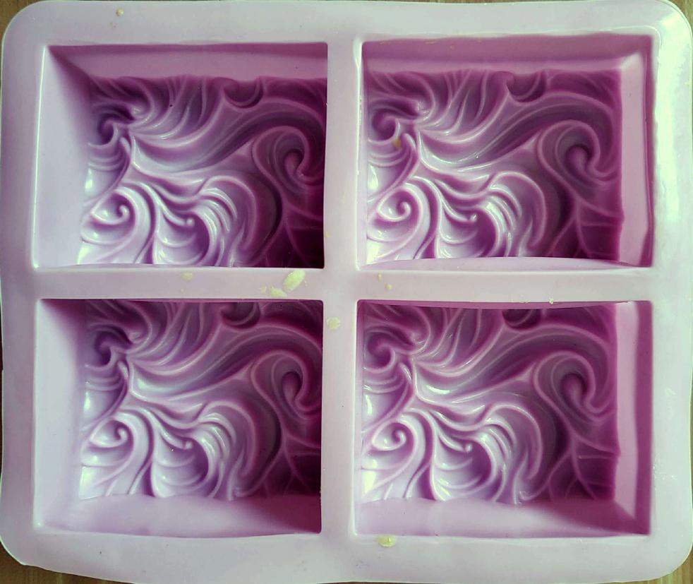

**metadata:** Stored in Box 12AV; priced against Flipkart listing.

**uses:** Cast patterned artisanal soap bars with a decorative face, or pour square-format wax melts with a textured top in the style of our wax tablets.

## 56. Clear polycarbonate chocolate mould, shell-shaped (~24 cavities)

**title:** Polycarbonate Shell-Shaped Chocolate Mould (~24 Cavities)

**description:** A rigid clear polycarbonate (PC) mould producing shiny, professional-finish shell-shaped chocolates — the kind of equipment used by serious chocolatiers. Surplus unused from our relocation, in clean ready-to-use condition. Delivers the mirror finish silicone can't.

**salePrice:** ₹788 per mould

**quantity:** 1 mould available

**image:** 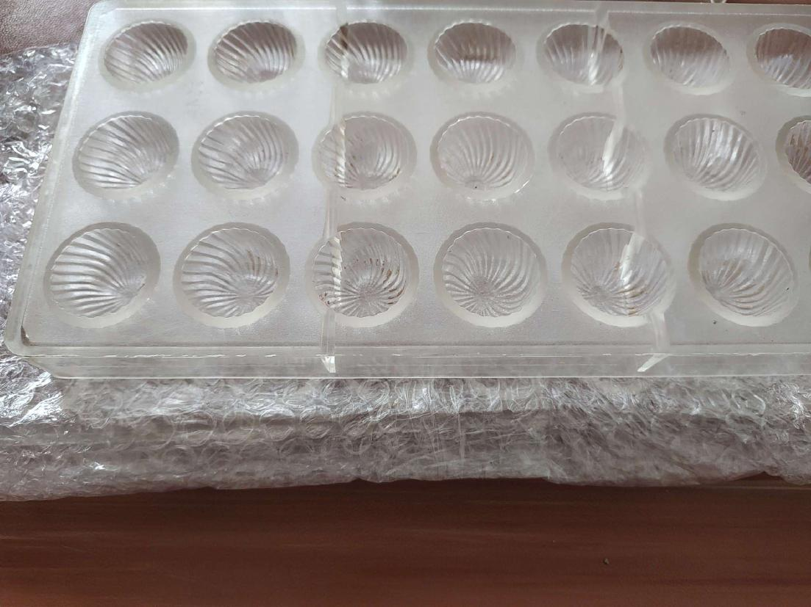

**metadata:** Stored in Box 12AV; price is a market-rate estimate, no exact listing found.

**uses:** Use directly to produce professional bonbons for a chocolate gift line, or cast glossy shell-shaped wax embeds to top our premium jar candles and hampers.

## 57. Clear polycarbonate chocolate mould, fluted round cavities

**title:** Polycarbonate Fluted Round Chocolate Mould (Pair)

**description:** Two clear polycarbonate moulds with fluted round cup-shaped cavities — the standard shape for professional-grade praline and tart-style chocolates. Surplus unused from our relocation, in clean ready-to-use condition. Premium tooling at a resale price.

**salePrice:** ₹638 per mould

**quantity:** 2 moulds available

**image:** 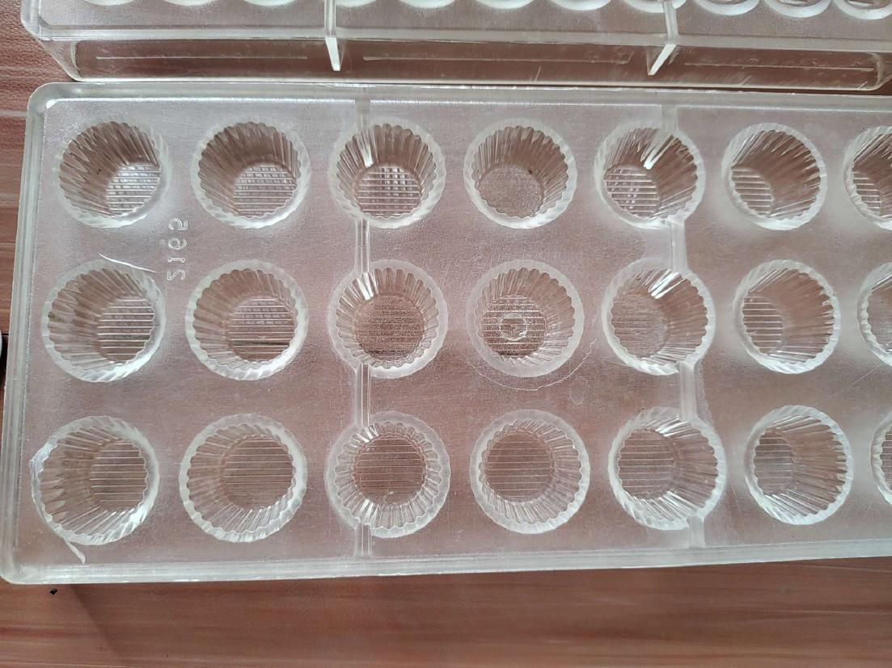

**metadata:** Stored in Box 12AV; price is a market-rate estimate, no exact listing found.

**uses:** Ideal for chocolatiers producing fluted bonbons; alternatively, cast ornamental wax medallions to decorate the top of a dough-bowl or metallic-bowl candle for premium gifting.

## 58. Clear polycarbonate chocolate mould, oval/almond dense grid (~77 cavities)

**title:** Large Polycarbonate Almond/Oval Chocolate Mould (~77 Cavities)

**description:** Two stacked rigid polycarbonate moulds with a dense grid of around 77 small oval/almond-shaped cavities each — built to mass-produce almond-shaped pralines or dragees. Surplus unused from our relocation, in clean ready-to-use condition. Serious production capacity.

**salePrice:** ₹938 per mould

**quantity:** 2 moulds available

**image:** 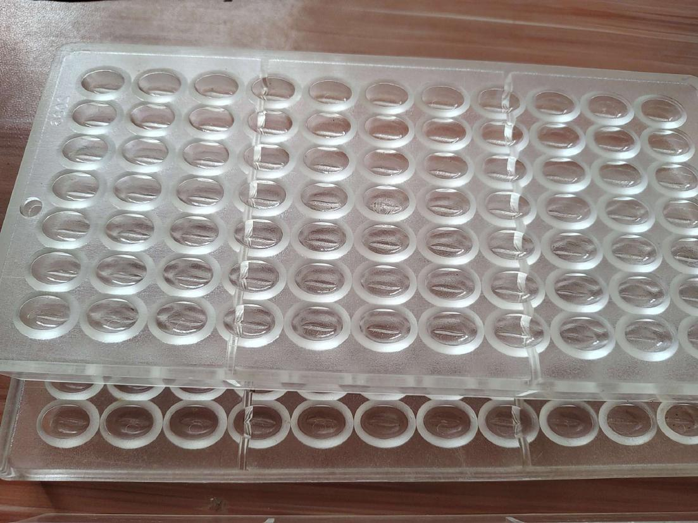

**metadata:** Stored in Box 12AV; price is a market-rate estimate, no exact listing found.

**uses:** Perfect for anyone scaling a chocolate dragee or almond-praline line, or for casting dozens of small decorative wax embeds in one pour for candle-topping and hamper filler.

## 59. Clear polycarbonate bar/wax-melt sheet moulds

**title:** Clear Bar / Wax-Melt Sheet Mould

**description:** Clear sheet moulds with rectangular bar cavities, sized for pouring wax melts, chocolate bars, or soap bars. Surplus unused from our relocation, in clean ready-to-pour condition. A workhorse format for small-batch production.

**salePrice:** ₹150 per mould

**quantity:** 5 moulds available

**image:** 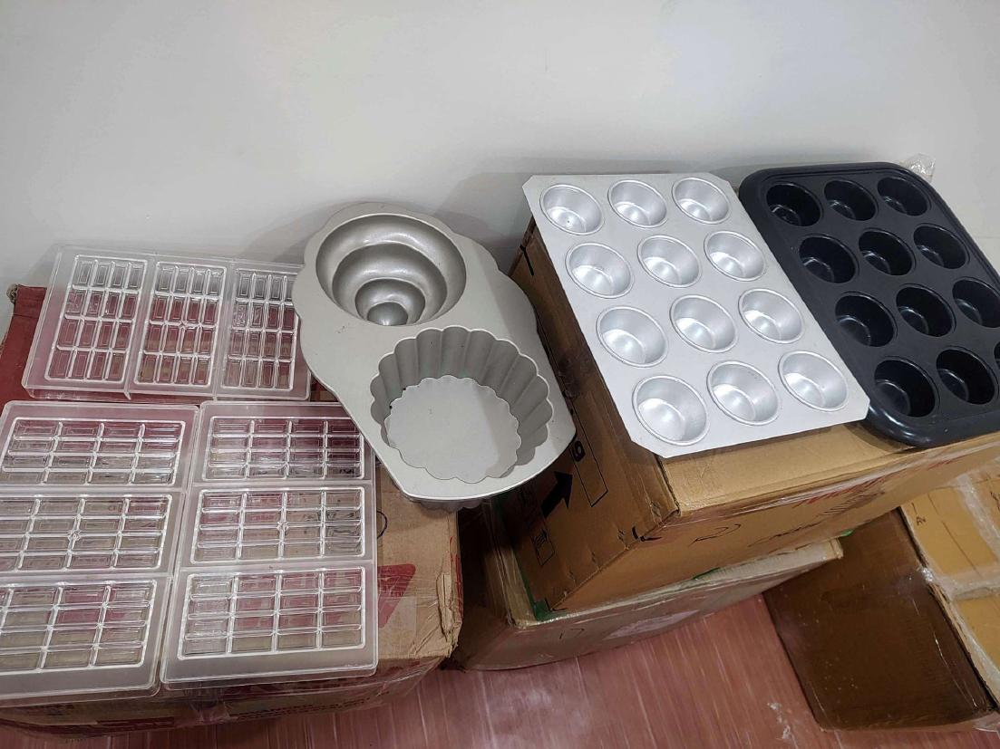

**metadata:** Carton location unclear; priced against Flipkart listing.

**uses:** Ideal for pouring our signature wax tablets (pack-of-3 and pack-of-1 formats) in bulk, or for making soap/chocolate bars for gifting bundles.

## 60. Brown silicone 6-cavity bear/animal mould

**title:** 6-Cavity Bear / Animal Silicone Mould

**description:** A brown silicone 6-cavity mould with bear or assorted animal shapes — a fun format for kids' soaps, chocolates, and jellies. Surplus unused stock from our relocation, in clean ready-to-pour condition. Reliable kid-friendly novelty.

**salePrice:** ₹158 per mould

**quantity:** 1 mould available

**image:** 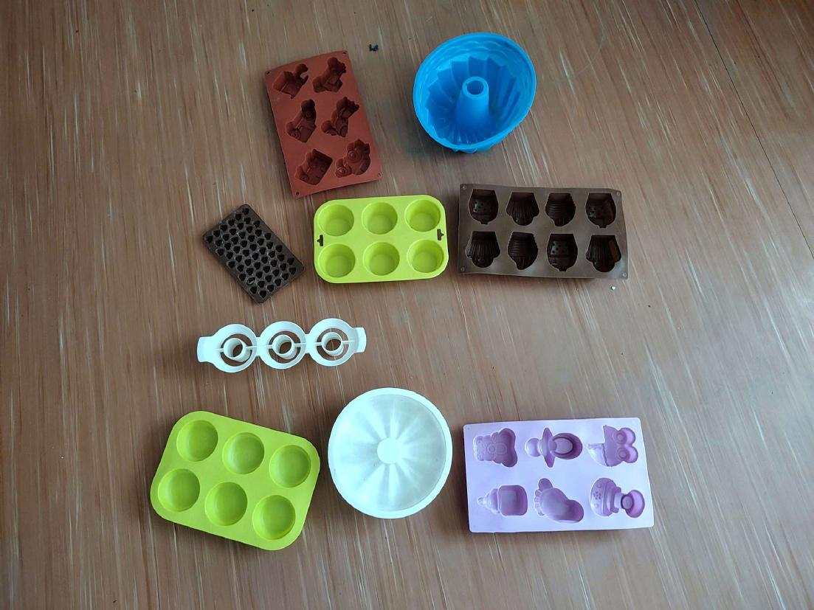

**metadata:** Stored in Box 12AV / Box 19AV (one box of moulds — overlap in correlation file); priced against Flipkart listing.

**uses:** Cast kids' novelty soaps and chocolates for birthday hampers, or pour cute bear-shaped wax melts alongside our wax tablet range.

## 61. Blue silicone bundt/fluted mould

**title:** Bundt / Fluted Silicone Mould

**description:** A flexible blue silicone mould shaped like a traditional fluted bundt cake — equally useful for bundt bakes and for casting large pillar candles or ornamental soap bars with a swirled/grooved finish. Surplus unused from our relocation, in clean ready-to-pour condition.

**salePrice:** ₹221 per mould

**quantity:** 1 mould available

**image:** 

**metadata:** Stored in Box 12AV / Box 19AV (one box of moulds — overlap in correlation file); priced against Flipkart listing.

**uses:** Pour a dramatic fluted pillar candle — a decorative cousin to our mini candle urli and metallic bowl candle — or cast statement bundt-shaped artisanal soaps.

## 62. Black plastic mini-honeycomb tray

**title:** Mini-Honeycomb Plastic Tray Mould

**description:** A rigid black plastic tray with small hexagonal (honeycomb) cavities — ready for mini bee/honey themed wax melts, soaps, chocolates, or embed shapes to drop into larger candles. Surplus unused from our relocation, in clean ready-to-use condition.

**salePrice:** ₹150 per tray

**quantity:** 1 tray available

**image:** 

**metadata:** Stored in Box 12AV / Box 19AV (one box of moulds — overlap in correlation file); priced against Flipkart listing.

**uses:** Pour mini honeycomb wax embeds to decorate our amber jar, matte jar, or metallic bowl candles, or cast small honey-themed soaps and chocolates for a bee-themed gift hamper.

## 63. Green silicone 6-cavity cupcake mould

**title:** Green Silicone 6-Cavity Cupcake / Wax Melt Mould

**description:** A flexible green silicone tray with six fluted cupcake-shaped cavities, in clean unused condition as surplus stock from a studio relocation. Equally suited to baking cupcakes/muffins or pouring soy wax and melt-and-pour soap base. Buyers get a versatile multi-use mould at well below Flipkart retail.

**salePrice:** ₹131 per mould

**quantity:** 2 moulds available

**image:** 

**metadata:** Box 12AV / Box 19AV (one box of moulds — overlap in correlation file); priced against Flipkart listing.

**uses:** Perfect for pouring six small soy-wax tablets at once — a ready production tool for wax tablet packs (singles or packs of 3) like those sold on Flipkart. Also works directly for home baking of cupcakes and muffins.

## 64. Brown silicone 8-cavity fluted cupcake/madeleine mould

**title:** Brown Silicone 8-Cavity Madeleine / Ribbed Candle Mould

**description:** Soft brown silicone tray with eight classic ribbed shell/madeleine-style cavities, unused surplus from a candle-and-bake studio clearing out after relocation. Releases detailed ribbed shapes cleanly, making it just as useful for wax and soap casting as for French madeleine cookies.

**salePrice:** ₹206 per mould

**quantity:** 1 mould available

**image:** 

**metadata:** Box 12AV / Box 19AV (one box of moulds — overlap in correlation file); priced against Flipkart listing.

**uses:** Cast small ribbed wax melts, decorative soap bars, or chocolate shells — the shell silhouette doubles beautifully as scented wax tablets or gift-hamper fillers alongside amber-jar or metallic candles.

## 65. White plastic 3-ring sphere/bath-bomb mould strip

**title:** 3-Cavity Sphere Bath Bomb / Candle Mould Strip

**description:** Rigid two-piece white plastic sphere mould with three joined cavities, unused leftover from studio supplies. Press together with bath-bomb mixture or use for casting perfectly round pillar candles and chocolates — releases clean spheres every time.

**salePrice:** ₹150 per mould

**quantity:** 1 mould available

**image:** 

**metadata:** Box 12AV / Box 19AV (one box of moulds — overlap in correlation file); priced against Flipkart listing.

**uses:** Ideal for making bath bombs, sphere-shaped soaps, or small round pillar candles for hampers. A nice sibling-mould for making decorative candle spheres to pair with dough bowl or matki candles.

## 66. White silicone fluted dome mould

**title:** White Silicone Fluted Dome Mould

**description:** Flexible silicone mould that produces a rounded, vertically-ribbed dome, in clean unused condition as relocation surplus. Equally effective for mousse/entremet desserts, pillar-dome candles, and ornamental soap bars.

**salePrice:** ₹206 per mould

**quantity:** 1 mould available

**image:** 

**metadata:** Box 12AV / Box 19AV (one box of moulds — overlap in correlation file); priced against Flipkart listing.

**uses:** Great for pouring a sculptural fluted-dome pillar candle, or a feature soap/mousse. The ribbed dome shape feels in-line with decorative pillar candles that could sit alongside amber jar or metallic candle designs.

## 67. Pink/lilac silicone baby-themed 6-cavity mould

**title:** Pastel Baby-Shower 6-Cavity Silicone Mould

**description:** Pastel pink/lilac silicone mould with six cavities shaped as baby-shower motifs (bottle, pram, booties, teddy, etc.), unused surplus from studio supplies. Clean release makes it well-suited to fondant toppers, favour soaps, and small decorative candles.

**salePrice:** ₹169 per mould

**quantity:** 1 mould available

**image:** 

**metadata:** Box 12AV / Box 19AV (one box of moulds — overlap in correlation file); priced against Flipkart listing.

**uses:** Pour small themed wax tablets or favour-sized soaps for baby showers — a niche but strong seller for shower return gifts. Also usable for fondant/chocolate toppers in a bakery setup.

## 68. White plaster/soap sample, sea-life embossed design

**title:** Sea-Life Embossed Plaster / Soap Sample Piece

**description:** A single finished sample cast — most likely a plaster or soap bar made from a sea-life themed silicone mould (shells, starfish, fish). A one-off display/demo piece being cleared with the rest of the studio inventory.

**salePrice:** ₹94 per piece

**quantity:** 1 piece available

**image:** 

**metadata:** Carton 4; priced against Flipkart listing.

**uses:** Useful as a display sample for craft stalls, a decorative tray/shelf object, or a fragrance-free soap-style decor piece. Primarily standalone decor — not raw material for a full product line.

## 69. Aluminium bundt-style tiered swirl cake tin

**title:** Aluminium Tiered Swirl Bundt Cake Tin

**description:** Metal aluminium cake pan with a central tube and spiralling tiered-swirl exterior pattern, surplus unused bakeware from a candle-and-bake studio relocation. Produces dramatic sculptural bundt cakes with minimal effort.

**salePrice:** ₹262 per piece

**quantity:** 1 piece available

**image:** 

**metadata:** Carton location unclear; priced against Flipkart listing.

**uses:** Primarily a baking tool for sculptural bundt cakes, but equally usable for pouring a tiered-swirl pillar candle in soy/paraffin blend — a visually striking variation on standard matki/pillar candles.

## 70. Aluminium fluted round tart tin

**title:** Aluminium Fluted Round Tart Tin

**description:** Round aluminium tart pan with fluted/scalloped side walls (removable loose base variants common), surplus unused stock from the relocation. Classic go-to pan for quiches, tarts and pies with a clean decorative edge.

**salePrice:** ₹188 per tin

**quantity:** 1 tin available

**image:** 

**metadata:** Carton location unclear; priced against Flipkart listing.

**uses:** Straightforward home/bakery use for tarts and quiches. Also usable as a wide-fluted candle pour vessel if you want a short, decorative pillar form.

## 71. Silver aluminium 12-cup muffin tray

**title:** Silver Aluminium 12-Cup Muffin Tray

**description:** Rectangular aluminium tray with twelve round cupcake/muffin cavities, unused surplus stock being cleared after a studio move. Essential bakeware for batch cupcakes and muffins — and a huge time-saver if pouring small container candles.

**salePrice:** ₹525 per tray

**quantity:** 1 tray available

**image:** 

**metadata:** Carton location unclear; priced against Flipkart listing.

**uses:** Pour 12 small wax tablets or tealight-sized candles in one go — a direct production accelerator for anyone selling wax tablet packs on Flipkart. Equally fine for everyday cupcake baking.

## 72. Black non-stick 12-cup muffin tray

**title:** Black Non-Stick 12-Cup Muffin Tray

**description:** 12-cavity carbon-steel muffin tray with a black non-stick finish, surplus unused stock from the relocation. Easier release and cleaning than bare aluminium, which matters for clean batch output.

**salePrice:** ₹488 per tray

**quantity:** 1 tray available

**image:** 

**metadata:** Carton location unclear; priced against Flipkart listing.

**uses:** Great for batch-pouring small container candles or wax tablets with cleaner release, in addition to the standard cupcakes and muffins. Pairs well for anyone producing wax tablet multi-packs.

## 73. Gold-tone 12-cup muffin tray

**title:** Gold-Tone 12-Cup Premium Muffin Tray

**description:** Premium gold-coloured non-stick carbon-steel 12-cup muffin tray, unused surplus from the studio. The gold finish gives it a more upscale look than standard black non-stick — nice for gifting/photoshoots.

**salePrice:** ₹675 per tray

**quantity:** 1 tray available

**image:** 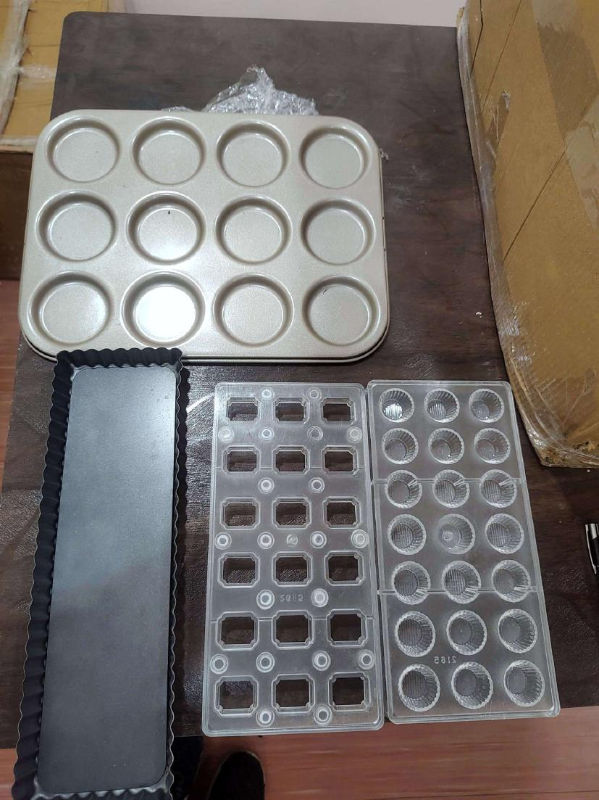

**metadata:** Carton location unclear; price is a market-rate estimate, no exact listing found.

**uses:** Batch-bake cupcakes and muffins for premium gifting, or batch-pour small wax tablets and tealights — well-suited to running a Flipkart wax-tablet production line.

## 74. Black rectangular fluted loaf/tart pan (removable base)

**title:** Rectangular Fluted Tart / Loaf Pan with Removable Base

**description:** Rectangular tart/loaf pan with fluted side walls and a loose/removable bottom, unused surplus from the studio. Lifts rectangular tarts out cleanly with a decorative ribbed edge.

**salePrice:** ₹262 per piece

**quantity:** 1 piece available

**image:** 

**metadata:** Carton location unclear; priced against Flipkart listing.

**uses:** Baking rectangular quiches/tarts with a clean release. Also usable as a long fluted candle-pour vessel if you want a decorative rectangular bar-shaped pillar candle.

## 75. Polycarbonate 18-cavity cube chocolate mould

**title:** Polycarbonate 18-Cavity Cube Chocolate Mould (Professional)

**description:** Rigid clear polycarbonate sheet mould with 18 cube/square-pocket cavities, unused professional-grade mould from studio supplies. Polycarbonate is the industry standard for glossy, snap-release bonbons — a step up from consumer silicone copies.

**salePrice:** ₹600 per mould

**quantity:** 1 mould available

**image:** 

**metadata:** Carton location unclear; price is a market-rate estimate, no exact listing found.

**uses:** Primarily for making premium chocolates with a mirror finish. Equally usable for casting small glossy wax cubes to use as decorative inclusions in container candles, or for scented wax-melt cubes.

## 76. Polycarbonate 21-cavity fluted round chocolate mould

**title:** Polycarbonate 21-Cavity Fluted Round Chocolate Mould

**description:** Clear rigid polycarbonate sheet mould with 21 small fluted (ridged/basket-weave) round cavities, unused professional-grade mould from the studio. Produces glossy fluted truffle shells with a premium high-shine finish.

**salePrice:** ₹600 per mould

**quantity:** 1 mould available

**image:** 

**metadata:** Carton location unclear; price is a market-rate estimate, no exact listing found.

**uses:** Great for a chocolatier making fluted truffle shells. For candle-makers, cast small fluted wax inclusions or miniature scented wax tablets as gift-hamper fillers.

## 77. Round aluminium cake pan

**title:** Round Aluminium Cake Pan

**description:** Plain round aluminium cake tin — the workhorse pan for standard round sponge or butter cakes. Clean, unused surplus from the relocation.

**salePrice:** ₹165 per piece

**quantity:** 1 piece available

**image:** 

**metadata:** Carton 4; priced against Flipkart listing.

**uses:** Essential bake-day staple for sponge and butter cakes. Equally usable as a round candle-pour vessel for wide, low-profile container candles.

## 78. Black non-stick bundt/ring cake tin

**title:** Black Non-Stick Bundt / Ring Cake Tin

**description:** Metal ring-shaped cake tin with a central tube and a black non-stick coating, unused surplus from the studio. Delivers clean release for classic bundt/ring cakes.

**salePrice:** ₹262 per piece

**quantity:** 1 piece available

**image:** 

**metadata:** Carton 4; priced against Flipkart listing.

**uses:** Straight-up bundt cakes for home or bakery use. Pours well as a ring-shaped candle too — a nice variant on standard pillar/matki forms.

## 79. White fluted silicone cake mould

**title:** White Fluted Silicone Cake Mould

**description:** Flexible white silicone cake mould with a fluted/scalloped side profile, unused surplus stock being cleared with the rest of the studio inventory. Produces a decorative ribbed round cake, mousse dome, or large pillar candle.

**salePrice:** ₹206 per mould

**quantity:** 1 mould available

**image:** 

**metadata:** Carton 4; priced against Flipkart listing.

**uses:** Doubles as a large decorative pillar candle mould — think fluted statement candles in the same visual family as the metallic candle bowl or concrete candle ranges.

## 80. Pink silicone loaf mould

**title:** Pink Silicone Loaf Mould

**description:** Rectangular pink silicone loaf-pan mould, unused surplus from the relocation. Flexible and easy to unmould, suited to loaf cakes, breads, soap loaves (for slab-cut bars) and pillar-style candles.

**salePrice:** ₹158 per mould

**quantity:** 1 mould available

**image:** 

**metadata:** Carton 4; priced against Flipkart listing.

**uses:** Pour a cold-process soap loaf and slice into bars, or cast a long rectangular pillar candle. Also fine for everyday banana bread / plum cake baking.

## 81. Metal wire cooling rack

**title:** Metal Wire Cooling Rack

**description:** Wire grid rack (typically stainless or carbon steel) used to let freshly baked cakes, cookies, and breads cool evenly from all sides. Clean, unused surplus from the studio.

**salePrice:** ₹281 per piece

**quantity:** 1 piece available

**image:** 

**metadata:** Carton 4; priced against Flipkart listing.

**uses:** Standard baking utility — cool cakes, biscuits, and breads properly without soggy bottoms. Also handy as a draining rack for freshly dipped candles or soaps.

## 83. Round wood-slice tree-cross-section serving tray

**title:** Natural Wood-Slice Serving Board

**description:** Decorative round serving platter cut from a cross-section of tree trunk, keeping the natural bark edge. Unused surplus from a stylist/photoshoot setup being cleared after the relocation. Rustic, warm, and ready for use.

**salePrice:** ₹356 per tray

**quantity:** 1 tray available

**image:** 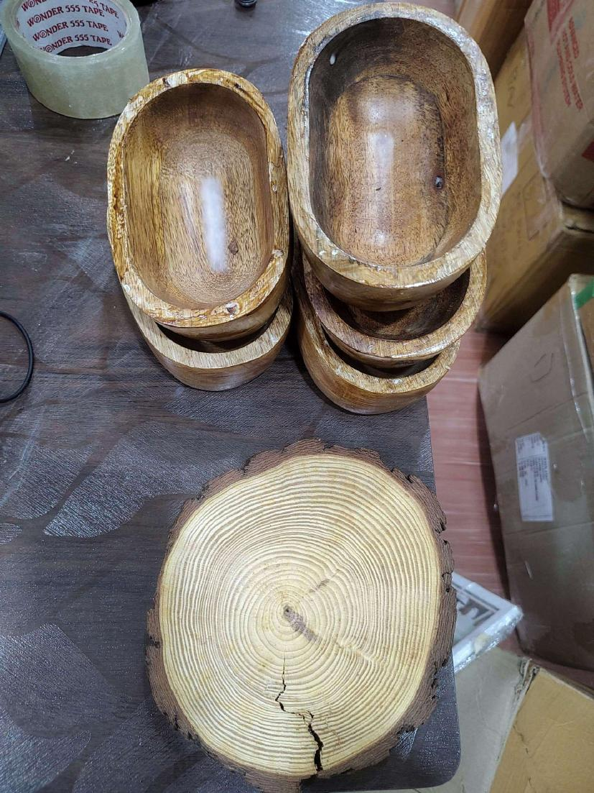

**metadata:** Box 13 / 1AV; priced against Flipkart listing.

**uses:** Perfect as a rustic base platter for cheese, charcuterie, or dessert styling. Doubles brilliantly as a styling prop / photo plate under dough bowl or matki candles for product photography.

## 84. Rectangular mango-wood tray with glossy chilli-print interior

**title:** Mango-Wood Tray with Chilli-Print Enamel Interior

**description:** Handcrafted mango-wood rectangular tray with a glossy red-and-pink chilli-pattern enamel/resin interior. Unused surplus from studio inventory, cleared post-relocation. A statement serve-ware piece with real artisan character.

**salePrice:** ₹562 per tray

**quantity:** 1 tray available

**image:** 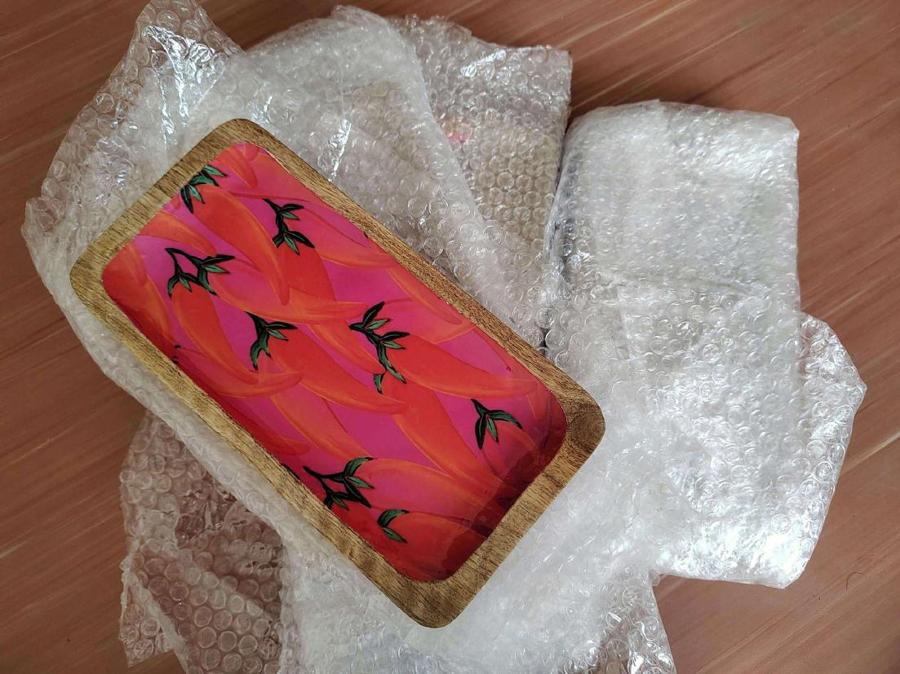

**metadata:** Box 12AV; priced against Flipkart listing.

**uses:** Ready-to-use decorative tray for serving, catch-all, or trousseau/gift styling. Also works as a premium hamper base — fill with jar candles, wax tablets and a journal for a built-in Flipkart-style hamper.

## 87. Carved wooden oval dough bowls (mango wood)

**title:** Hand-Carved Oval Mango-Wood Dough Bowls

**description:** Hand-carved oval wooden bowls in mango wood, with the rustic farmhouse profile that works for kneading dough or decoratively holding bread and fruit. Unused surplus stock from the studio, in clean condition.

**salePrice:** ₹600 per piece

**quantity:** 6 pieces available

**image:** 

**metadata:** Box 13 / 1AV; priced against Flipkart listing.

**uses:** These are exactly the base vessel for a dough bowl candle — pour soy wax with multiple wicks and sell as the signature dough-bowl candle featured on Flipkart. Also usable standalone as farmhouse serve ware.

## 95. Qartistic palette/painting knife set, stainless, 5pc

**title:** Stainless Steel Palette Knife Set (5pc), Sealed

**description:** Sealed blister-pack set of 5 stainless-steel palette/painting knives with brown wooden handles, numbered 1–5. Still in retail packaging with original barcodes — brand new, surplus from studio supplies.

**salePrice:** ₹206 per set

**quantity:** 5 sets available

**image:** 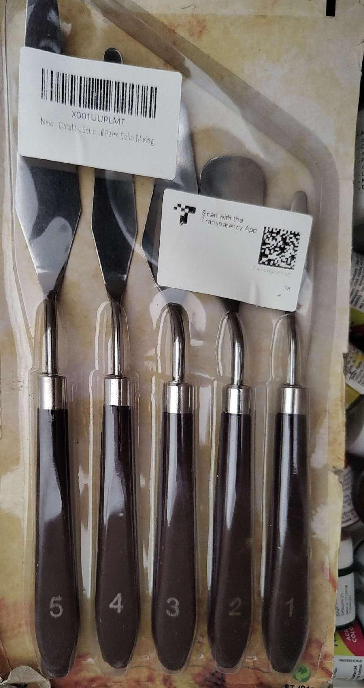

**metadata:** Box 12AV; priced against Flipkart listing.

**uses:** Perfect for artists working in acrylic/oil impasto, or for mixing resin, pigments, and colour pastes. Also useful in a candle-making workflow for mixing fragrance oils and dyes into wax, or for smoothing concrete-candle surfaces.

## 99. Rose-gold rectangular metal gift tins

**title:** Rose-Gold Rectangular Metal Gift Tins

**description:** Rose-gold finish metal (tin/aluminium) rectangular boxes with lids, unused surplus gifting supplies from the studio. Clean, premium look suited to higher-tier gifting.

**salePrice:** ₹375 per tin

**quantity:** 4 tins available

**image:** 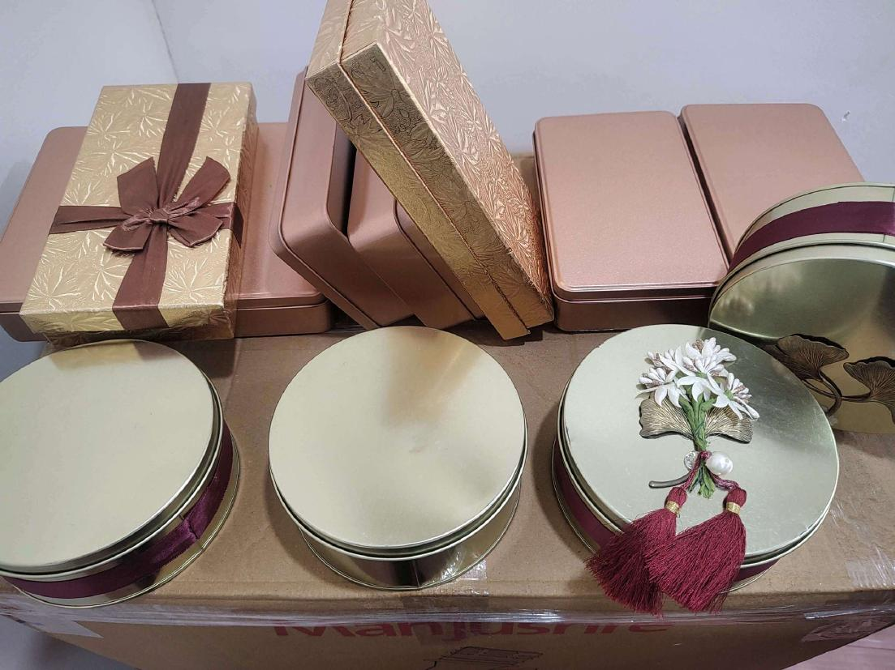

**metadata:** Carton 1; priced against Flipkart listing.

**uses:** Ideal hamper/gift packaging — pack with wax tablets, mini candle urlis or amber jar candles to build a Flipkart-style candle gift hamper (Illuminate / Enhance / Assorted 6-types).

## 100. Champagne/gold textured paper gift boxes with ribbon

**title:** Champagne Textured Paper Gift Boxes with Ribbon

**description:** Rigid paperboard gift boxes with textured gold/champagne finish and satin ribbon detailing, unused surplus from the studio's gifting supplies. Give products an immediate luxury wrap.

**salePrice:** ₹375 per box

**quantity:** 2 boxs available

**image:** 

**metadata:** Carton 1; priced against Flipkart listing.

**uses:** Ready gift packaging for hamper-style candle/soap sets — exactly the box format for building Illuminate 1 & 2, Enhance, or Vertical Bliss Birthday hampers.

## 101. Round gold-lidded gift tins

**title:** Round Gold-Lidded Gift Tins

**description:** Cylindrical metal tin containers with press-fit decorative gold lids, unused surplus from studio gifting stock. Classic premium gifting form factor, often paired with ribbon or flower accents.

**salePrice:** ₹165 per tin

**quantity:** 3 tins available

**image:** 

**metadata:** Carton 1; priced against Flipkart listing.

**uses:** Use directly as the vessel for a tin-candle — pour scented soy wax inside to create a gift tin candle. Also a ready container for cookies, dry fruits, or trinket gifting.

## 102. Decorative floral embellishment pick (flowers + pearl + tassel)

**title:** Floral + Pearl + Tassel Gift Embellishment Pick

**description:** Ornamental decorative pick combining an artificial flower, strung pearls, and a hanging silk tassel (latkan). Unused surplus from gifting supplies — adds an instant Indian-wedding feel to any tray or hamper.

**salePrice:** ₹131 per piece

**quantity:** 1 piece available

**image:** 

**metadata:** Carton 1; priced against Flipkart listing.

**uses:** Finishing touch for wedding/trousseau trays and premium candle gift hampers — stick on top of a paper gift box lid to elevate a candle hamper from basic to gift-ready.

## 103. Bubble wrap rolls (various widths)

**title:** Bubble Wrap Rolls (Various Widths)

**description:** Air-bubble polyethylene cushioning film in rolls, surplus packaging stock cleared after the studio relocation. Standard widths from 300mm up to 1000mm — ideal for protecting fragile items in transit.

**salePrice:** ₹195 per roll

**quantity:** 1+5 rolls available

**image:** 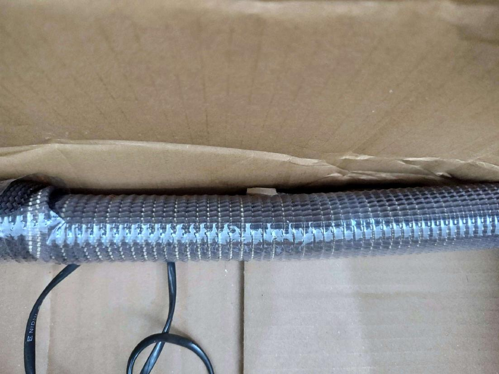

**metadata:** Carton 1; priced against Flipkart listing.

**uses:** Essential shipping protection for anyone selling glass-jar candles, soaps, or ceramics online. If you're already shipping Flipkart orders, this goes straight into your dispatch workflow.

## 104. Cream "2 Brownie Box" flat-pack folding bakery boxes (10pcs/pack)

**title:** Cream 2-Brownie Window Bakery Boxes (Pack of 10)

**description:** Pre-scored paperboard folding boxes sized for two brownie slices, with a clear scalloped window on the lid. Shrink-wrapped flat pack of 10, brand new and unused — surplus packaging from the studio.

**salePrice:** ₹225 per box

**quantity:** 10 boxs available

**image:** 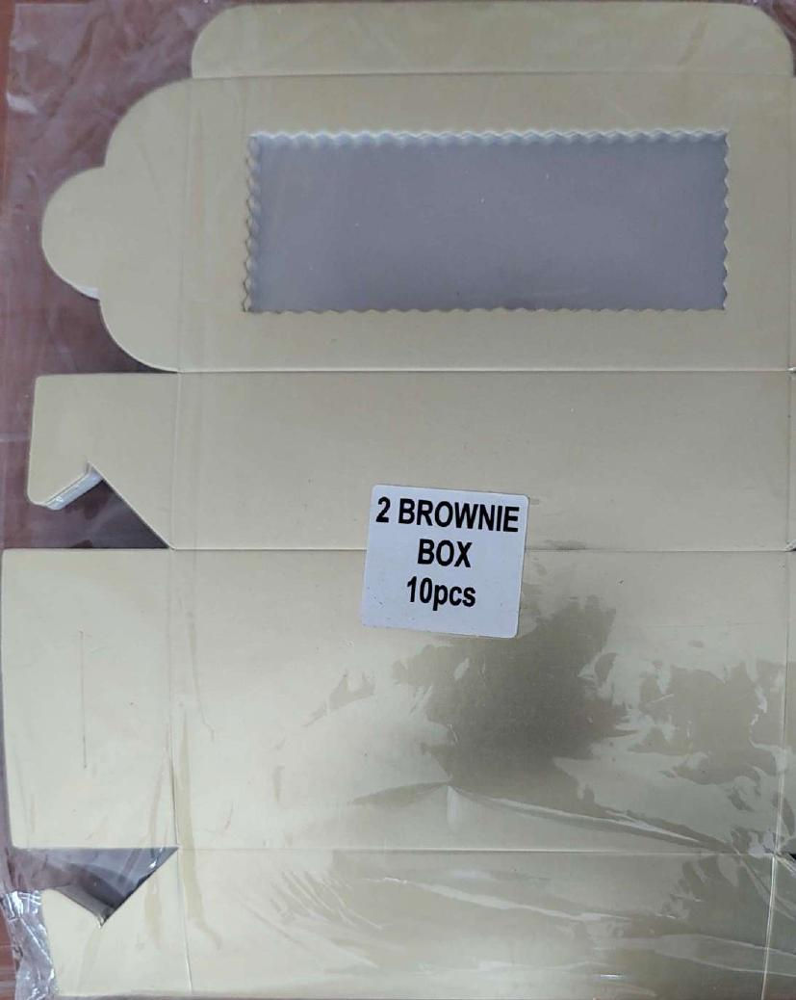

**metadata:** Box 18AV; priced against Flipkart listing.

**uses:** Ready retail packaging for bakers selling brownies, cookies, or fudge. Also neat for packaging a pair of wax tablets or small mini-candles as window-display gift sets.

## 105. Gold metallic zip-lock stand-up mylar pouches, empty

**title:** Gold Matt Zip-Lock Stand-Up Mylar Pouches

**description:** Resealable aluminium-foil laminated stand-up pouches with a matt gold finish and zip-lock closure. Food-grade, unused surplus packaging from the studio's gifting and product lines.

**salePrice:** ₹21 per pouch

**quantity:** 5-6+1 pouchs available

**image:** 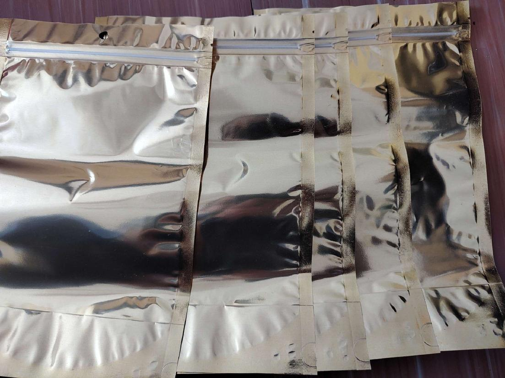

**metadata:** Box 18AV; priced against Flipkart listing.

**uses:** Perfect retail packaging for wax melts/wax tablets, bath salts, loose teas, or snacks. A natural pack format for shipping wax-tablet multi-packs like the ones sold on Flipkart.

## 106. Flat corrugated kraft cardboard box blanks (die-cut, 8-10)

**title:** Die-Cut Kraft Corrugated Box Blanks — Flat Pack (8-10 pcs)

**description:** Pre-creased, die-cut 3-ply kraft corrugated flats that fold into small pastry/takeaway-style cartons. Surplus unused stock from our workshop relocation, still in the original clear plastic bag. Ideal for anyone who needs ready-to-fold small shipping or gift cartons without ordering a full case.

**salePrice:** ₹24 per box

**quantity:** 1 (quantity not individually countable in photo; sold as a single lot) box available

**image:** 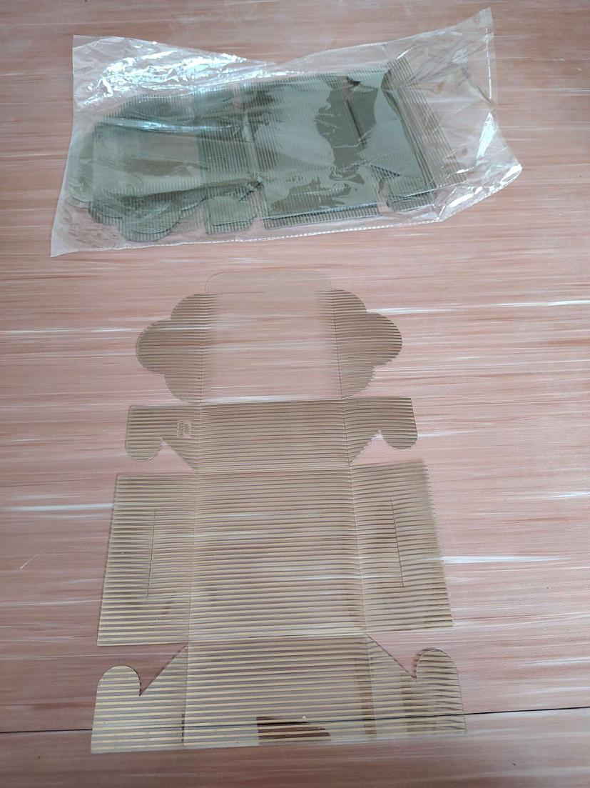

**metadata:** Stored in Box 18AV; priced against Flipkart listing.

**uses:** Perfect as mailer/outer cartons for shipping small candles or soap bars, or as inner trays inside a candle gift hamper (Illuminate / Enhance style sets).

## 107. Rectangular gold-foil-covered gifting trays / box bases

**title:** Gold-Foil Rectangular Gifting Trays — Hamper Bases

**description:** Rigid cardboard trays laminated in gold-metallic foil paper, several still sealed in their original clear plastic wrap. Surplus unused stock from relocation. A ready-made premium base for mithai gifting, wedding hampers or home-made candle gift sets.

**salePrice:** ₹244 per tray

**quantity:** 4-5 trays available

**image:** 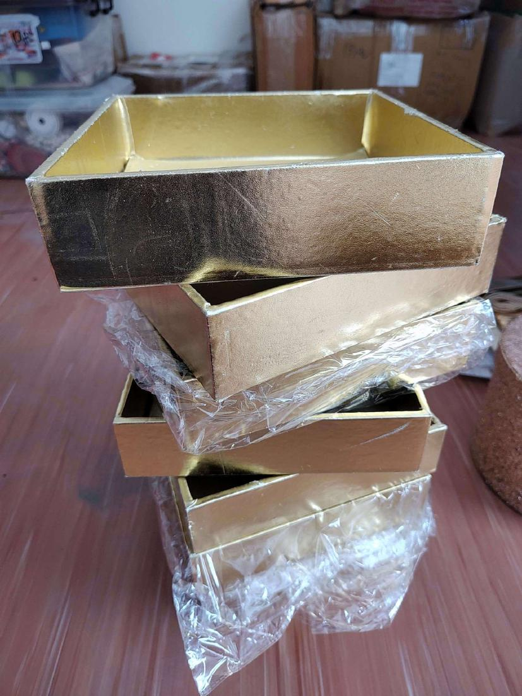

**metadata:** Stored in Box 18AV; priced against Flipkart listing.

**uses:** Drop in three or four candles, wax tablets and a resin bookmark and you have an instant Illuminate-style candle gift hamper ready to resell.

## 108. Square gold-foil gifting box with silk interior + lid (1 set)

**title:** Square Gold-Foil Gift Box with Silk-Lined Interior

**description:** A single rigid two-piece gift box in gold-foil paper, lined inside with cream/gold silk-like fabric and finished with a shoulder lid. Unused surplus from relocation. A premium presentation box suited to mithai, dry-fruit, jewellery or a signature candle.

**salePrice:** ₹600 per tin

**quantity:** 1 tin available

**image:** 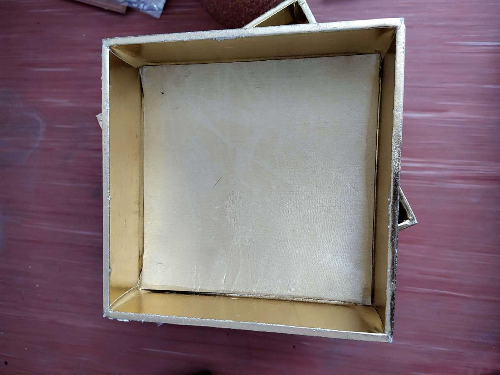

**metadata:** Stored in Box 18AV; priced against Flipkart listing.

**uses:** Houses a single Amber Jar or Metallic Candle Bowl beautifully — repurpose as a luxury single-candle gift presentation box.

## 109. Round glitter gifting box (silver/champagne)

**title:** Silver-Champagne Glitter Round Gift Box with Lid

**description:** Cylindrical rigid cardboard gift box in silver-champagne glitter paper, coming with shredded kraft-and-foil crinkle filler already inside. Unused surplus from relocation. Great for an eye-catching gift presentation straight out of the box.

**salePrice:** ₹262 per tin

**quantity:** 1 tin available

**image:** 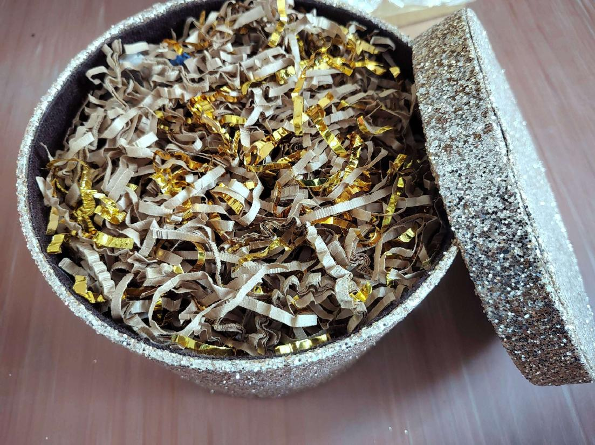

**metadata:** Stored in Box 18AV; price is a market-rate estimate, no exact listing found.

**uses:** The crinkle fill is already in place — nest a Triple Wick Holographic Matki or a Holographic Candle inside for a ready-to-sell festive hamper.

## 110. Rose-gold glitter cylindrical gift box

**title:** Rose-Gold Glitter Cylindrical Gift Box

**description:** Tall round rigid gift box with a snug lid, finished in rose-gold/copper glitter paper. Surplus unused stock from our relocation. A pretty, wedding-season-ready hamper base or standalone return-gift box.

**salePrice:** ₹281 per box

**quantity:** 1 box available

**image:** 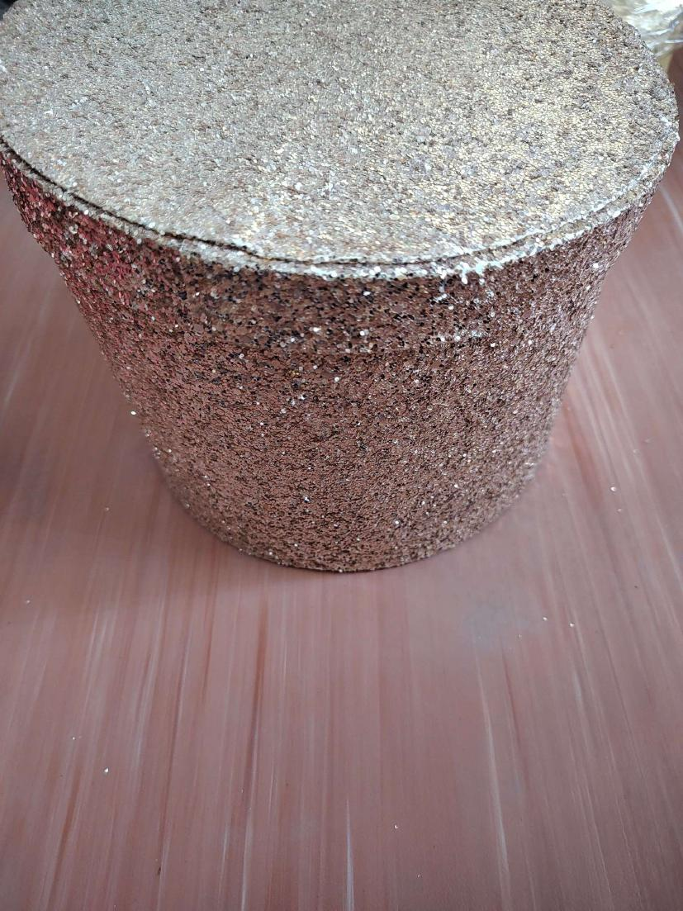

**metadata:** Stored in Box 18AV; priced against Flipkart listing.

**uses:** Ideal as the vessel for a wedding return-gift hamper — fits a Mini Candle Urli or Metallic Candle Bowl nicely with room for wax tablets alongside.

## 111. Hot-pink square paper gift box, gold lotus-print lid

**title:** Hot-Pink Square Gift Box with Gold Lotus-Print Lid

**description:** Square rigid cardboard gift box in hot pink, paired with a separate shoulder lid printed with a gold foil lotus motif. Surplus unused stock from relocation. A festive, wedding/Diwali-coded box that photographs beautifully as hamper packaging.

**salePrice:** ₹206 per box

**quantity:** 1+1 boxs available

**image:** 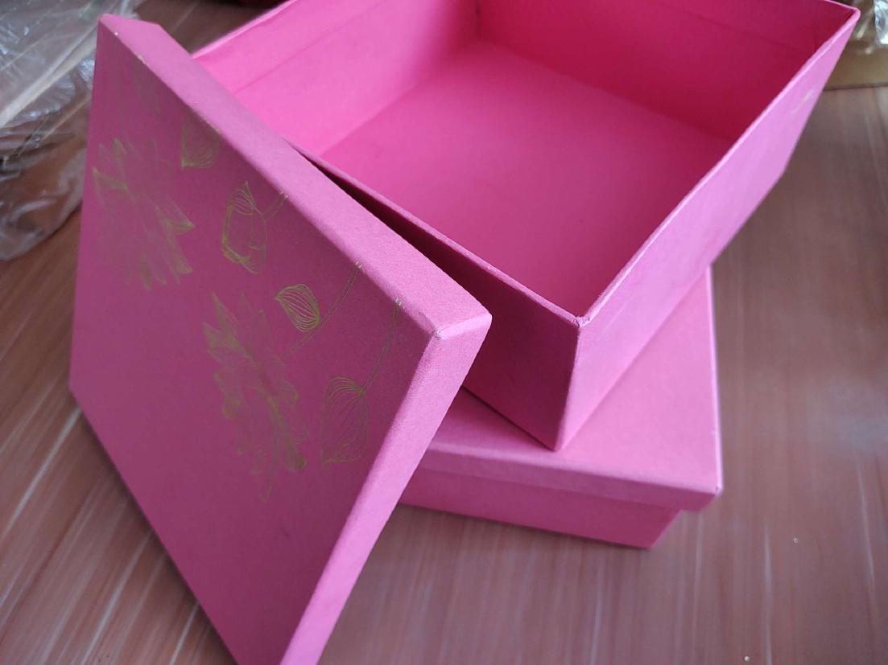

**metadata:** Stored in Box 18AV; priced against Flipkart listing.

**uses:** A great outer for an Illuminate 2 or Vertical Bliss Birthday-style hamper where you want a pop of colour on the gifting shelf.

## 112. Plain kraft / mustard rigid rectangular gift box

**title:** Plain Kraft / Mustard Rigid Rectangular Gift Box

**description:** A sturdy two-piece rectangular gift box in plain kraft/mustard finish, with lid-and-base construction. Surplus unused stock from relocation. Clean, minimal packaging that works just as well for artisan products as for hampers.

**salePrice:** ₹206 per box

**quantity:** 1 box available

**image:** 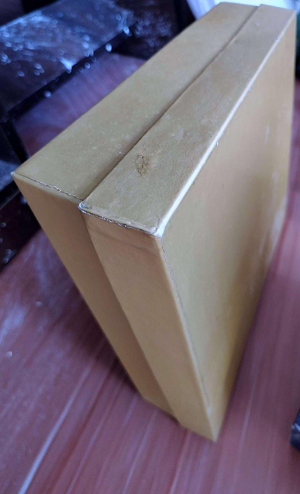

**metadata:** Stored in Box 18AV; priced against Flipkart listing.

**uses:** Perfect outer box for a minimalist candle gift hamper — pairs well with a Dough Bowl Candle or a Matte Jar Candle plus a gratitude journal.

## 113. Navy-blue hinged presentation box with gold clasp

**title:** Navy Hinged Presentation Box with Gold Clasp

**description:** A rectangular hinged-lid presentation box upholstered in navy blue with a decorative gold-tone clasp. Unused surplus from relocation. The interior is lined in matching navy — a premium feel suited to higher-end gifts.

**salePrice:** ₹450 per box

**quantity:** 1+1 boxs available

**image:** 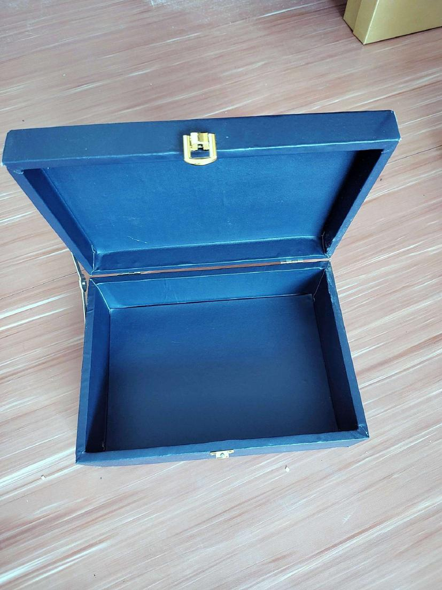

**metadata:** Stored in Box 18AV; priced against Flipkart listing.

**uses:** An elegant presentation shell for a single premium candle (Le Noir / Concrete Candle) or a resin bookmark + journal pairing.

## 114. Hexagonal paper gifting trays (pink/gold floral print, 8-9)

**title:** Pink & Gold Hexagonal Paper Gifting Trays (set of 8-9)

**description:** Nested set of hexagonal paperboard trays printed with traditional pink-and-gold floral/lattice motifs. Surplus unused stock from relocation. Ideal as mithai, dry-fruit or hamper insert trays for wedding and festive gifting.

**salePrice:** ₹36 per tray

**quantity:** 3+5-6 trays available

**image:** 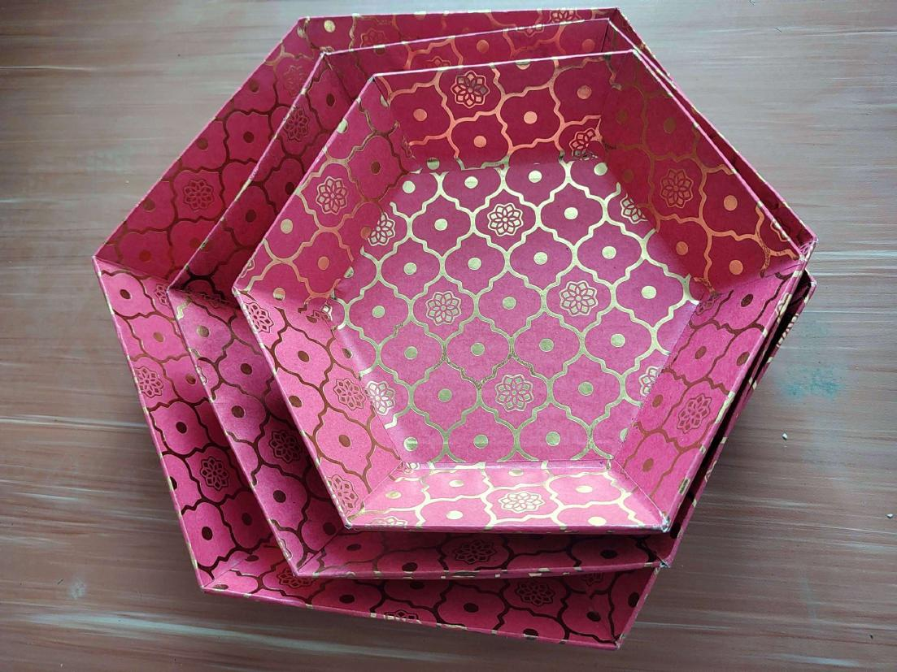

**metadata:** Stored in Box 18AV; price is a market-rate estimate, no exact listing found.

**uses:** Line the base of an Illuminate or Assorted 6-types hamper with one tray and nest wax tablets or soaps inside for a tidy, wedding-ready presentation.

## 115. Rectangular paper gifting trays (pink/gold print, 3-4)

**title:** Pink & Gold Rectangular Paper Gifting Trays (set of 3-4)

**description:** Paper-covered rectangular trays in the same pink-and-gold floral/lattice print as the hexagonal set. Surplus unused stock from relocation. A matched addition for hamper styling or mithai presentation.

**salePrice:** ₹206 per tray

**quantity:** 3-4 trays available

**image:** 

**metadata:** Stored in Box 18AV; priced against Flipkart listing.

**uses:** Pairs with the hexagonal trays (item 114) as the base tray in a larger candle gift hamper — fits two-three jar candles plus wax tablets side by side.

## 116. Flat-pack kraft gift bags, oval die-cut handles

**title:** Kraft Gift Bags with Die-Cut Oval Handles — Flat Pack

**description:** Brown kraft paper gift bags with punched oval cut-out handles, shipped flat-packed to save space. Surplus unused stock from relocation. Handy, inexpensive return-gift or small-order packaging.

**salePrice:** ₹18 per bag

**quantity:** 6-8 bags available

**image:** 

**metadata:** Stored in Box 18AV; priced against Flipkart listing.

**uses:** Perfect carrier bag for a small return-gift hamper — slip in a pair of wax tablets and a resin bookmark and you have a tidy giveaway.

## 117. Rose-gold crocodile-embossed gifting trunks with brass clasp (3)

**title:** Rose-Gold Crocodile-Embossed Gifting Trunk with Brass Clasp

**description:** Rigid trunk-style gift box covered in rose-gold faux-leather with crocodile-skin embossing and a decorative brass clasp — one of three in the set, the lowest still in its original clear packaging. Surplus unused stock from relocation. A luxury trousseau/jewellery/wedding trunk straight off the shelf.

**salePrice:** ₹788 per tin

**quantity:** 3+1 tins available

**image:** 

**metadata:** Stored in Box 18AV; priced against Flipkart listing.

**uses:** A striking outer for a high-ticket candle gift hamper — fits a full Illuminate 2 or Assorted 6-types set with room to spare.

## 118. Flat-packed small brown corrugated shipping boxes (25-30)

**title:** Small Brown Corrugated Shipping Boxes — Flat Pack (25-30 pcs)

**description:** Bundle of small 3-ply brown kraft corrugated shipping cartons (~4x4 to 8x5 inches), delivered flat-packed. Surplus unused stock from relocation. Workhorse packaging for anyone shipping candles, soaps or small gifts.

**salePrice:** ₹12 per box

**quantity:** 25-30 boxs available

**image:** 

**metadata:** Stored in Box 18AV; priced against Flipkart listing.

**uses:** The standard outer carton for Flipkart-style shipments — sized for a single jar candle or a 2-3 wax-tablet pack.

## 120. Wonder 555 packing tape roll

**title:** Wonder 555 BOPP Packing Tape Roll (2-inch)

**description:** Standard 2-inch BOPP packing/sealing tape by Wonder 555, suited to sealing cardboard shipping cartons. Surplus unused stock from relocation. A basic consumable for any small resale or packaging operation.

**salePrice:** ₹39 per roll

**quantity:** 1 roll available

**image:** 

**metadata:** Stored in Box 13 / 1AV; priced against Flipkart listing.

**uses:** The go-to tape for sealing the flat-pack corrugated cartons (items 106 and 118) once you've folded them up for dispatch.

## 127. Gold/copper foil paper sheets (large)

**title:** Gold & Copper Foil Paper Sheets — Bulk Craft Pack

**description:** Decorative gold and copper foil paper sheets in a large format, used in gilding, gift wrapping, decoupage and craft embellishment. Surplus unused stock from relocation. A versatile addition to any craft or gift-styling kit.

**salePrice:** ₹226 per sheet

**quantity:** 8-10 sheets available

**image:** 

**metadata:** Stored in Carton 2; priced against Flipkart listing.

**uses:** Use as gilding on Concrete Candles or Dough Bowl Candles for a gold-leaf accent, or as luxe wrapping inside Illuminate-style hampers.

## 128. "Craft Bug — Craft Essentials" foil craft pack

**title:** Craft Bug "Craft Essentials" Foil Craft Pack

**description:** A sealed starter pack from Mumbai-based Craft Bug containing assorted gilding leaf sheets or metallic foil flakes with adhesive for DIY and resin craft. Surplus unused stock from relocation. Still in original retail packaging.

**salePrice:** ₹281 per pack

**quantity:** 1 pack available

**image:** 

**metadata:** Stored in Carton 2; price is a market-rate estimate, no exact listing found.

**uses:** Drop foil flakes into resin bookmark pours for a marbled gold finish, or press onto wet concrete candles for a gilded accent.

## 129. Red foil wrapping sheets

**title:** Red Foil Wrapping Sheets — Bulk Pack

**description:** Red metallic aluminium foil wrapping sheets for sweets, chocolates and festive gift wrapping. Surplus unused stock from relocation. Great seasonal/festive inventory for a confectioner or gifting business.

**salePrice:** ₹124 per sheet

**quantity:** 2-3 sheets available

**image:** 

**metadata:** Stored in Carton 2; priced against Flipkart listing.

**uses:** Use as the inner lining or accent wrap in a Love Candle / Birthday Glitter Candle hamper for a pop of festive red.

## 130. Gold metallic twist-tie wires (bulk)

**title:** Gold Metallic Twist-Tie Wires — Bulk Pack

**description:** Bulk stacks of gold metallic-coated twist-tie wires for closing cellophane bags, bakery boxes and favour pouches. Surplus unused stock from relocation. A tidy, inexpensive finishing touch for any packaging line.

**salePrice:** ₹129 per piece

**quantity:** approx 500+ pieces available (bulk lot across two trays)

**image:** 

**metadata:** Stored in Carton 2; priced against Flipkart listing.

**uses:** Perfect for sealing clear cellophane wraps around wax tablet packs or around the top of a Mini Candle Urli for a gift-ready finish.

## 131. White embossed non-woven filter cones/piping bags (pack)

**title:** White Non-Woven Filter Cones / Piping Bags

**description:** Pack of disposable white non-woven fabric piping bags or filter cones, still in their original Chinese-printed packaging. Surplus unused stock from relocation. Suited to cake decorating, candle-pouring, or straining.

**salePrice:** ₹133 per bag

**quantity:** 50-100 bags available

**image:** 

**metadata:** Stored in Carton 2; priced against Flipkart listing.

**uses:** Handy as disposable pouring bags when filling small candle moulds or wax-tablet trays — no mess, single use.

## 133. Matte-black round decorative plates/chargers (~20-25cm)

**title:** Matte-Black Round Decorative Chargers (set of 4)

**description:** Set of four matte-black round decorative plates/chargers in the 20-25 cm range, cushioned in bubble wrap. Surplus unused stock from relocation. Clean, modern styling surfaces for home decor or product photography.

**salePrice:** ₹206 per piece

**quantity:** 4 pieces available

**image:** 

**metadata:** Stored in Box 12AV; priced against Flipkart listing.

**uses:** Use as under-plates when photographing or displaying candles for your Flipkart listings — the matte black lets Metallic/Holographic candles pop.

## 134. Brass/gold-tone round decorative plate/tray

**title:** Brass/Gold-Tone Round Decorative Plate/Tray

**description:** A round brass or gold-plated decorative tray/plate suited to home decor styling, pooja thali or serving. Surplus from relocation, bubble-wrapped and ready to use.

**salePrice:** ₹788 per tray

**quantity:** 1 tray available

**image:** 

**metadata:** Carton location unclear; priced against Flipkart listing.

**uses:** Doubles as a photo-styling base for product shoots, or gift it as part of a festive home-decor hamper paired with a Metallic Candle Bowl.

## 135. Brass/gold-tone fan-shaped decorative piece

**title:** Brass/Gold-Tone Fan-Shaped Decorative Showpiece

**description:** A brass/gold-finish fan-shaped decorative wall hanging or showpiece — often used as a Vastu/Feng Shui accent or styling piece. Surplus from relocation, bubble-wrapped.

**salePrice:** ₹750 per piece

**quantity:** 1 piece available

**image:** 

**metadata:** Carton location unclear; priced against Flipkart listing.

**uses:** Sell on as a standalone decor accent, or stage it in product photography behind metallic candles to give listings a ornate, festive backdrop.

## 136. Natural wood-slice coasters (round, bark edge)

**title:** Natural Wood-Slice Coasters with Bark Edge

**description:** Round wood-slice coasters cut from natural tree cross-sections, bark edge still intact — some loose, some already bagged in retail-ready packaging with printed barcodes. Surplus unused stock from relocation.

**salePrice:** ₹321 per piece

**quantity:** 1 piece available

**image:** 

**metadata:** Stored in Box 18AV; priced against Flipkart listing.

**uses:** Perfect rustic base to pour a small Dough Bowl Candle or Concrete Candle onto, or sell on as-is — the pre-barcoded packs are shelf-ready.

## 139. Red silk tassel bundle

**title:** Red Silk Tassel Bundle (15-20 pieces)

**description:** Bundle of 15-20 red silk thread tassels with gold-thread loops, sealed in a clear plastic pouch. Surplus unused stock from relocation. A ready-made embellishment for wedding favours, gifting and festive decor.

**salePrice:** ₹169 per bundle

**quantity:** 15-20 bundles available

**image:** 

**metadata:** Stored in Box 12AV; priced against Flipkart listing.

**uses:** Tie one to the lid of a Love Candle or Mini Candle Urli, or thread through the drawstring on a potli pouch to lift a return-gift hamper.

## 141. Heart-shaped flat cutouts (foam/cardstock, assorted colors)

**title:** Assorted Heart-Shaped Flat Cutouts (6 pcs)

**description:** Six large, flat die-cut heart shapes in assorted beige, pink, silver-foil and coral — foam, cardstock or MDF. Surplus unused stock from relocation. Nice accent toppers for scrapbooking, gift tags and craft embellishments.

**salePrice:** ₹169 per piece

**quantity:** 1 (quantity not individually countable in photo; sold as a single lot) piece available

**image:** 

**metadata:** Stored in Box 18AV; priced against Flipkart listing.

**uses:** Use as decorative gift-tag toppers on Love Candle hampers, or glue onto the lid of a candle gift box as a styled finishing touch.

## 145. Royal-blue velvet drawstring potli pouch

**title:** Royal-Blue Velvet Drawstring Potli Pouch

**description:** Soft royal-blue velvet drawstring pouch — the classic Indian gifting bag for return gifts, jewellery and wedding favours. Surplus unused stock from relocation.

**salePrice:** ₹262 per pouch

**quantity:** 1 pouch available

**image:** 

**metadata:** Stored in Box 12AV; priced against Flipkart listing.

**uses:** Slip in a pack of wax tablets or a resin bookmark pair to turn into a ready-to-sell premium return-gift pouch.

## 147. Stretched artist canvas, ~54x17cm

**title:** Panoramic Stretched Artist Canvas (~54x17cm)

**description:** Long-format, cotton pre-stretched canvas on a wooden frame, partially unwrapped from its original packaging and shipping label still attached. Surplus unused stock from relocation. Ideal for acrylic/oil painting or decor art projects.

**salePrice:** ₹225 per piece

**quantity:** 1 piece available

**image:** 

**metadata:** Stored in Box 12AV; priced against Flipkart listing.

**uses:** A ready-to-paint canvas for any artist — the panoramic shape works well for a mantel/above-sofa accent piece.

## 166. Wooden ice-cream/craft sticks (flat)

**title:** Flat Wooden Ice-Cream / Craft Sticks (bulk pack)

**description:** Natural flat wooden popsicle/craft sticks, stored in a clear plastic organiser box. Surplus unused stock from relocation. Workhorse supplies for any craft, baking or candle-making setup.

**salePrice:** ₹98 per piece

**quantity:** 100-150 pieces available

**image:** 

**metadata:** Stored in Carton 3; priced against Flipkart listing.

**uses:** Great as stirrers when mixing soy wax or fragrance oil for Wax Tablets / Dough Bowl Candles, or as wick-holders across the top of a jar while candles set.

## 167. Small disposable wooden spoons

**title:** Small Disposable Wooden Sampler Spoons (pack)

**description:** Pack of small disposable wooden tasting/sampler spoons, stored together with the craft sticks. Surplus unused stock from relocation. Versatile for desserts, soap/wax stirring and craft scooping.

**salePrice:** ₹98 per piece

**quantity:** 20-30 pieces available

**image:** 

**metadata:** Stored in Carton 3; priced against Flipkart listing.

**uses:** Perfect for scooping small amounts of fragrance oil, mica or dye into your wax pour when making Wax Tablets or Matte Jar Candles.

## 168. Bamboo skewers (shrink-wrapped bundle)

**title:** Bamboo Skewers — Shrink-Wrapped Bundle (~100 pcs)

**description:** Shrink-wrapped bundle of thin ~25cm bamboo skewers. Surplus unused stock from relocation. Multi-purpose for kebabs, craft structures, floral arrangements and candle-making.

**salePrice:** ₹94 per bundle

**quantity:** 100+ bundles available

**image:** 

**metadata:** Stored in Carton 3; priced against Flipkart listing.

**uses:** Use as wick-centering sticks when pouring Triple Wick Holographic Matki or Double Wick Holographic Candles — lay two across the top to keep wicks straight while wax sets.

## 169. Loose wooden sticks/dowels

**title:** Mixed Wooden Craft Sticks & Dowels — Bulk Lot

**description:** A mixed bundle of wooden craft dowels, ice-cream sticks, small wooden spoons and bamboo skewers in various lengths. Surplus unused supplies from a candle/craft studio relocation — clean and ready for reuse. Great value versus buying four separate packs.

**salePrice:** ₹139 per piece

**quantity:** 35 pieces available

**image:** 

**metadata:** Stored in Carton 3; priced against Flipkart listing.

**uses:** Candle-wick centering sticks, stirrers for wax and soap, floral stems, DIY models and kids' craft projects.

## 170. Cupcakes & Cashmere holiday silver baking/party cups

**title:** Cupcakes & Cashmere Silver Holiday Baking Cups — Boxed Set

**description:** Boxed set of silver foil-patterned baking/party cups with a festive Christmas gnome print on the bases, in original Cupcakes & Cashmere retail packaging. Unopened surplus stock from the studio move. A charming seasonal find for bakers and crafters.

**salePrice:** ₹169 per lid

**quantity:** 2 lids available

**image:** 

**metadata:** Carton location unclear; price is a market-rate estimate, no exact listing found.

**uses:** Cupcake and muffin liners, chocolate-truffle cups, or small candle-pour moulds for tealight-sized decorative candles.

## 171. Fevicryl Acrylic Colours jars, 15ml (various shades)

**title:** Fevicryl Acrylic Paint Jars 15ml — Assorted Shades, Bulk Basket

**description:** A basket crammed full of 15ml Fevicryl acrylic paint jars in a variety of shades, with a few other brands mixed in. Surplus studio stock in sealed/near-full condition from the relocation clear-out. Priced per jar — fantastic value for anyone starting out or stocking up.

**salePrice:** ₹26 per jar

**quantity:** 1 jar available

**image:** 

**metadata:** Stored in Box 12AV; priced against Flipkart listing.

**uses:** All-surface craft paint for canvas, wood, fabric, candle jars, terracotta and decoupage projects.

## 172. Fevicryl Acrylic Colours bottle, 500ml

**title:** Fevicryl Acrylic Colour 500ml Bottle — Bulk Base White

**description:** A large 500ml bottle of Fevicryl acrylic paint (base/background white), ideal for bulk craft and decor work. Unused surplus stock from studio relocation. Priced well below MRP.

**salePrice:** ₹286 per bottle

**quantity:** 1 bottle available

**image:** 

**metadata:** Stored in Box 12AV; priced against Flipkart listing.

**uses:** Priming craft bases, painting large canvases, coating candle jars, or mixing custom shades for decor projects.

## 173. Fevicryl Mod Podge (gloss decoupage glue)

**title:** Fevicryl Premium Mod Podge — Gloss Decoupage Glue

**description:** Fevicryl's premium gloss decoupage medium — an all-in-one glue, sealer and finish for decoupage and collage. Surplus unused bottle from studio relocation. A staple medium for anyone doing paper or fabric decoupage.

**salePrice:** ₹188 per piece

**quantity:** 1 piece available

**image:** 

**metadata:** Stored in Box 12AV; priced against Flipkart listing.

**uses:** Decoupage on wood, glass and candles; sealing napkin/paper prints onto craft surfaces; gloss finishing on painted decor.

## 174. Fevicryl Fabric Glue

**title:** Fevicryl Fabric Glue — Clear Flexible Adhesive

**description:** A bottle of clear, flexible fabric adhesive from Pidilite's Fevicryl range. Surplus unused stock from a candle/craft studio relocation. Perfect for no-sew embellishment work.

**salePrice:** ₹94 per piece

**quantity:** 1 piece available

**image:** 

**metadata:** Stored in Box 12AV; priced against Flipkart listing.

**uses:** Sticking trims, lace, patches, beads and sequins onto fabric for hamper lining, pouches and gift-wrap decoration without stitching.

## 175. Deco Magic Premium Decoupage Glue, 225ml

**title:** Little Birdie Deco Magic Decoupage Glue 225ml

**description:** A 225ml bottle of Little Birdie Deco Magic premium decoupage glue/sealer — an all-in-one glue and finish for decoupage. Unused surplus from the studio clear-out. A high-performing medium at a strong discount.

**salePrice:** ₹164 per bottle

**quantity:** 1 bottle available

**image:** 

**metadata:** Stored in Box 12AV; priced against Flipkart listing.

**uses:** Decoupage on wood, glass, candle jars and gift boxes; sealing painted finishes with a protective gloss layer.

## 176. Mod Podge Gloss-Lustre sealer, 236ml

**title:** Plaid Mod Podge Gloss 236ml (Imported USA) — Premium Craft Sealer

**description:** The original imported Plaid Mod Podge (USA) in an 8oz / 236ml bottle with a gloss-lustre finish — a premium decoupage glue, sealer and finish rolled into one. Surplus unused stock from a relocating candle studio. Imported pricing without the import mark-up.

**salePrice:** ₹544 per bottle

**quantity:** 1 bottle available

**image:** 

**metadata:** Stored in Box 12AV; price is a market-rate estimate, no exact listing found.

**uses:** High-grade decoupage and sealing on wood, canvas, glass and craft surfaces — the professional choice for durable gloss finishes.

## 177. Artecover Gesso White, 500ml

**title:** Artecover White Gesso Primer — 500ml

**description:** A 500ml bottle of Artecover white acrylic gesso primer — the base coat that makes acrylic paint stick and pop on canvas, wood and more. Unused surplus from the studio relocation. Standard supply for any acrylic painter.

**salePrice:** ₹217 per bottle

**quantity:** 2 bottles available

**image:** 

**metadata:** Stored in Box 12AV; priced against Flipkart listing.

**uses:** Priming canvases, wooden boards, MDF and ceramic surfaces before acrylic painting; also as a white base for mixed-media work.

## 178. Granotone Metallic Acrylic Paint set, 12 shades

**title:** Granotone Metallic Acrylic Paint Set — 12 Shades Boxed

**description:** A boxed Granotone acrylic paint set in 12 metallic shades — a specialty paint line used for metallic highlights on crafts, candles and decor. Surplus studio stock, boxed and sealed. Metallic finishes in bulk at a great discount.

**salePrice:** ₹1500 per set

**quantity:** 1 set available

**image:** 

**metadata:** Stored in Box 12AV; priced against Flipkart listing.

**uses:** Painting metallic highlights on candle jars, hamper boxes, resin pieces and canvases; ideal for festive/gold-finish decor.

## 179. Camel Fluid Acrylic Colours set, 18 shades x 50ml

**title:** Camel Fluid Acrylic Colours Set — 18 Shades x 50ml

**description:** An artist-grade Camlin/Camel Fluid Acrylic set with 18 shades in 50ml bottles — pourable, rich-pigment acrylics by Kokuyo Camlin. Surplus unused stock from the studio relocation. A comprehensive set at a significant saving.

**salePrice:** ₹1200 per set

**quantity:** 1 set available

**image:** 

**metadata:** Stored in Box 12AV; price is a market-rate estimate, no exact listing found.

**uses:** Fluid acrylic pouring art, canvas painting, abstract backgrounds, resin tinting and large-surface craft projects.

## 180. Camel Artists' Acrylic Colour tubes (120ml/40ml metallic)

**title:** Camel Artists' Acrylic Colour Tubes — 120ml & 40ml Metallic Shades

**description:** Artist-grade Camel (Kokuyo Camlin) acrylic colour tubes — 120ml standard shades plus 40ml metallic shades. Bagged surplus from a candle/craft studio relocation, in clean reusable condition. Excellent value versus buying individual tubes new.

**salePrice:** ₹283 per bottle

**quantity:** 2 bottles available

**image:** 

**metadata:** Stored in Box 12AV; priced against Flipkart listing.

**uses:** Acrylic painting on canvas, wood or craft surfaces; the metallic shades are perfect for accent work on candle jars and gift boxes.

## 181. Marie Signature Acrylic Colour Paint Set, 24 x 36ml

**title:** Marie / Mont Marte Signature Acrylic Paint Set — 24 Tubes x 36ml

**description:** A boxed "Marie Signature" (Mont Marte-style) acrylic paint set with 24 artist-grade 36ml tubes. Surplus unused set from the studio clear-out, with original flat packaging. Excellent starter or refresh kit at well below MRP.

**salePrice:** ₹1162 per set

**quantity:** 1 set available

**image:** 

**metadata:** Stored in Box 12AV; priced against Flipkart listing.

**uses:** General acrylic painting on canvas, wood, candles and craft surfaces; a strong all-round shade range for any painter.

## 182. Assorted paint brushes (flat/round/sponge dauber), 15–20 pcs

**title:** Assorted Artist Paint Brush Set — Flat, Round, Fan + Sponge Daubers (15–20 pcs)

**description:** A mixed set of 15–20 artist paint brushes in various shapes — flats, rounds, liner, fan — plus foam/sponge dauber tips. Surplus studio stock in clean, usable condition from the relocation. Covers almost every painting task in one lot.

**salePrice:** ₹300 per piece

**quantity:** 3 pieces available

**image:** 

**metadata:** Stored in Box 12AV; priced against Flipkart listing.

**uses:** Acrylic, watercolour, oil and craft painting on canvas, wood or ceramics; daubers for stencil work and candle-surface accents.

## 183. Qartistic palette/painting knife set, 5pc

**title:** 5-Piece Stainless-Steel Palette/Painting Knife Set — Sealed

**description:** A sealed blister-pack of 5 stainless-steel palette/painting knives with brown wooden handles, numbered 1–5 and still in retail packaging. Surplus studio stock from the relocation. New-in-pack condition at a cut price.

**salePrice:** ₹236 per set

**quantity:** 5 sets available

**image:** 

**metadata:** Stored in Box 12AV; priced against Flipkart listing.

**uses:** Mixing and applying acrylic/oil paint, creating textured artwork, and also handy for working with thick candle wax or soap paste.

## 189. Gold-painted artificial foliage sprig

**title:** Gold-Painted Artificial Foliage Sprig — Luxury Decor Accent

**description:** A single artificial foliage sprig with gold-painted leaves — a luxe decor accent typically used in festive hampers and candle displays. Surplus unused stock from the studio clear-out, in clean condition. Perfect for upscale gifting work.

**salePrice:** ₹158 per piece

**quantity:** 1 piece available

**image:** 

**metadata:** Stored in Box 12AV; priced against Flipkart listing.

**uses:** Luxury accent on candle lids, hamper fillers, pooja thali decor, wedding favours and festive table arrangements.

## 190. Terracotta decor blocks w/ pearl-beaded trim (2 bags)

**title:** Terracotta Decor Blocks with Pearl-Beaded Trim — 2 Bags

**description:** Two bagged lots of decorative terracotta clay cutouts edged with glued pearl-bead trim — a traditional Indian craft/gifting decor piece. Unused surplus from the studio relocation. Priced for the pair.

**salePrice:** ₹262 per bag

**quantity:** 2 bags available

**image:** 

**metadata:** Stored in Box 12AV; price is a market-rate estimate, no exact listing found.

**uses:** Wall-hangings, pooja/festive decor, hamper toppers and rustic table-scape accents — a ready-made ethnic craft upgrade.

## 191. Shredded paper / crinkle filler, mixed colors (navy / pink / straw), bulk

**title:** Bulk Crinkle-Cut Shredded Paper Filler — Mixed Colours

**description:** A bulk stash of crinkle-cut shredded paper filler in mixed colours (navy / pink / straw / kraft with gold foil shred). Pulled from a glittery gift-box tray — clean and reusable, surplus to the business after relocation. Essential packaging material for any gifting outfit.

**salePrice:** ₹180 per piece

**quantity:** 1 piece available

**image:** 

**metadata:** Stored in Box 18AV; priced against Flipkart listing.

**uses:** Cushioning and decorative filler inside gift boxes, candle hampers and product packaging trays.

## 192. Shrink-wrapped shipping carton, inbound courier parcel

**title:** Shrink-Wrapped Shipping Carton — Inbound Parcel (Packaging Only)

**description:** A corrugated shipping carton wrapped in shrink-film / courier poly, as received from a supplier. Not a sellable SKU on its own — value here is for the packaging material (carton + shrink film) only.

**salePrice:** ₹75 per piece

**quantity:** 1 piece available

**image:** 

**metadata:** Carton location unclear; price is a market-rate estimate, no exact listing found.

**uses:** Reusable outer shipping carton with shrink film — handy for re-couriering inventory or repurposing as sturdy storage.

## 193. Fine dining cutlery / chinaware set (per notes, boxes 6AV/7AV)

**title:** Fine Dining Cutlery & Chinaware Set — Complete Dinner Service

**description:** A multi-piece formal dining service — bone-china / ceramic plates plus stainless-steel cutlery — of the kind sold as a complete set. Stored as a household item through the studio relocation, now being cleared out. Priced well below mid-range dinner-set MRPs.

**salePrice:** ₹2550 per box

**quantity:** 1 set (not individually counted) box available

**image:** No photo available — sourced from handwritten inventory notes.

**metadata:** Stored across Box 6AV and Box 7AV (per notes); priced against Flipkart listing.

**uses:** Ready-to-use home dinner service for family or formal entertaining; could also be regifted as a wedding/housewarming present.

## 194. Kitchen party items — 40 sets of jar + lower stand (per notes box 10)

**title:** Kitchen Jar + Lower Stand Sets — Lot of 40

**description:** Forty sets of a decorative jar paired with a matching lower stand — the classic "party favour" / kitchen-gifting format (think spice jar, honey jar or small candle jar on a riser). Surplus bulk stock from the relocation, priced per set. A ready-to-flip bulk lot for another gifting seller.

**salePrice:** ₹244 per jar

**quantity:** 40 jars available

**image:** No photo available — sourced from handwritten inventory notes.

**metadata:** Stored in Box 10 (per notes); priced against Flipkart listing.

**uses:** Resell individually as spice/honey jars, candle holders, or wedding-favour sets; also usable as mini candle vessels on their own risers.

## 195. KK gift hampers — 24 total (12x2), candle + soap + wax tablets + coaster (per notes box 8)

**title:** Branded Gift Hampers — Candle + Soap + Wax Tablets + Coaster (Lot of 24)

**description:** Twenty-four finished artisanal gift hampers (two cartons of 12), each containing a scented candle, handmade soap, wax-melt tablets and a coaster — directly comparable to the Avnika Bhandari Illuminate / Enhance / Assorted Candle hampers sold on Flipkart. Fully boxed, sellable as-is. Priced per hamper.

**salePrice:** ₹544 per box

**quantity:** 24 boxs available

**image:** No photo available — sourced from handwritten inventory notes.

**metadata:** Stored in Box 8 (per notes); priced against Flipkart listing.

**uses:** Ready-to-sell finished gift hampers — identical in format to the seller's own Flipkart hamper SKUs; resellable immediately for wedding favours, corporate gifting or Diwali/festive sales.

## 196. 35 boxes of ready-made candles (per notes box 14)

**title:** Ready-Made Scented Jar Candles in Retail Boxes — Lot of 35

**description:** Thirty-five finished scented candles in glass jars, each packed in its own retail gift box — the business's own production, ready for retail sale. Priced per box, well below the normal Flipkart price point. A ready inventory for any gifting reseller.

**salePrice:** ₹262 per box

**quantity:** 35 boxs available

**image:** No photo available — sourced from handwritten inventory notes.

**metadata:** Stored in Box 14 (per notes); priced against Flipkart listing.

**uses:** Ready-to-sell finished product — directly comparable to the seller's amber/matte/holographic jar candles on Flipkart; resell as-is, gift individually, or bundle into bigger hampers.

## 197. Nitrile gloves — 20 (per notes)

**title:** Powder-Free Disposable Nitrile Gloves — 20 pcs

**description:** Twenty powder-free disposable nitrile examination gloves, surplus from a candle-making studio. Previously stocked for use with hot wax, dyes and fragrance oils. Clean unused gloves at a small-pack price.

**salePrice:** ₹54 per piece

**quantity:** 20 pieces available

**image:** No photo available — sourced from handwritten inventory notes.

**metadata:** Carton location unclear (per notes); priced against Flipkart listing.

**uses:** Handling hot wax, dyes, fragrance oils and soap base without skin contact or staining; also handy for resin, cleaning and general craft work.

## 198. A4 yellow art & craft sheets — 30 (per notes)

**title:** A4 Yellow Craft Paper Sheets — Pack of 30

**description:** Thirty A4-size yellow coloured craft paper sheets (typical craft gsm) — surplus studio stock from the relocation. Ready for scrapbooking, wrap, and lining projects. Priced below standard pack rate.

**salePrice:** ₹116 per sheet

**quantity:** 30 sheets available

**image:** No photo available — sourced from handwritten inventory notes.

**metadata:** Carton location unclear (per notes); priced against Flipkart listing.

**uses:** Scrapbooking, origami, gift wrapping, box lining for hampers, and school/kids' art projects.

## 199. Red wooden trays, 28x15cm — multiple (per notes)

**title:** Red Painted Wooden Hamper Trays — Approx 28 x 15 cm

**description:** Multiple painted red mango-wood / MDF serving trays approximately 28 × 15 cm — used as hamper bases and decorative trays. Surplus unused stock from the studio clear-out. Priced per tray.

**salePrice:** ₹412 per tray

**quantity:** quantity not specified in notes tray available

**image:** No photo available — sourced from handwritten inventory notes.

**metadata:** Carton location unclear (per notes); priced against Flipkart listing.

**uses:** Base trays for candle/soap hampers, serving trays, pooja/festive platters, or decorative trinket trays for home decor.

## 200. Transparent/silicone bee-shaped moulds, 9.5cm — 7 (per notes)

**title:** Transparent Silicone Bee-Shaped Moulds, 9.5 cm — Pack of 7

**description:** Seven transparent silicone moulds in bee / honeybee shapes (approx 9.5 cm), matching the honey/beeswax product line of the studio. Unused surplus from the relocation. Priced per mould.

**salePrice:** ₹169 per mould

**quantity:** 7 moulds available

**image:** No photo available — sourced from handwritten inventory notes.

**metadata:** Carton location unclear (per notes); priced against Flipkart listing.

**uses:** Casting bee-themed scented candles, melt-and-pour soaps, wax-melt tablets and resin paperweights — ideal for honey/beeswax themed hampers.

## 201. Glass jar, small, transparent — 8.5 cm

**title:** Small Transparent Glass Candle Jar — 8.5 cm

**description:** A small clear glass jar, approx 8.5 cm, from the "Jars — Glass/Metal" lot noted in Carton 1 (BOXES-RD). Surplus studio stock, unused.

**salePrice:** ₹90 per piece

**quantity:** 1 (quantity not specified in notes) piece available

**image:** No photo available — sourced from handwritten inventory notes (nikkiBoxes.MD).

**metadata:** Carton 1 (per notes, "1) JARS - GLASS/METAL", BOXES-RD); flat-priced per user instruction, not independently researched.

**uses:** A compact container candle vessel — well suited to mini candle urli pours or small gifting candles.

## 202. Glass jar, transparent — 6.5 cm

**title:** Transparent Glass Candle Jar — 6.5 cm

**description:** A clear glass jar, approx 6.5 cm, from the "Jars — Glass/Metal" lot noted in Carton 1. Surplus studio stock, unused.

**salePrice:** ₹90 per piece

**quantity:** 1 (quantity not specified in notes) piece available

**image:** No photo available — sourced from handwritten inventory notes (nikkiBoxes.MD).

**metadata:** Carton 1 (per notes); flat-priced per user instruction, not independently researched.

**uses:** Small container candle vessel for mini pours or sample-size gifting candles.

## 203. Glass jar, medium, transparent — 7.5 cm

**title:** Medium Transparent Glass Candle Jar — 7.5 cm

**description:** A clear glass jar, medium size, approx 7.5 cm, from the "Jars — Glass/Metal" lot noted in Carton 1. Surplus studio stock, unused.

**salePrice:** ₹90 per piece

**quantity:** 1 (quantity not specified in notes) piece available

**image:** No photo available — sourced from handwritten inventory notes (nikkiBoxes.MD).

**metadata:** Carton 1 (per notes); flat-priced per user instruction, not independently researched.

**uses:** Mid-size container candle vessel, suitable for standard jar candle pours (matte jar candle, amber jar candle style).

## 204. Glass jar, transparent — 9.5 cm

**title:** Transparent Glass Candle Jar — 9.5 cm

**description:** A clear glass jar, approx 9.5 cm, from the "Jars — Glass/Metal" lot noted in Carton 1. Surplus studio stock, unused.

**salePrice:** ₹90 per piece

**quantity:** 1 (quantity not specified in notes) piece available

**image:** No photo available — sourced from handwritten inventory notes (nikkiBoxes.MD).

**metadata:** Carton 1 (per notes); flat-priced per user instruction, not independently researched.

**uses:** Standard-size container candle vessel for jar candle pours.

## 205. Glass/metal jar, metallic finish — 8 cm

**title:** Metallic-Finish Candle Jar — 8 cm

**description:** A candle jar with a metallic finish, approx 8 cm, from the "Jars — Glass/Metal" lot noted in Carton 1. Surplus studio stock, unused.

**salePrice:** ₹90 per piece

**quantity:** 1 (quantity not specified in notes) piece available

**image:** No photo available — sourced from handwritten inventory notes (nikkiBoxes.MD).

**metadata:** Carton 1 (per notes); flat-priced per user instruction, not independently researched.

**uses:** Matches the look of the metallic candle / metallic candle bowl product lines — a ready vessel for a metallic-finish pour.

## 206. Glass/metal jar, metallic finish — 7.5 cm

**title:** Metallic-Finish Candle Jar — 7.5 cm

**description:** A candle jar with a metallic finish, approx 7.5 cm, from the "Jars — Glass/Metal" lot noted in Carton 1. Surplus studio stock, unused.

**salePrice:** ₹90 per piece

**quantity:** 1 (quantity not specified in notes) piece available

**image:** No photo available — sourced from handwritten inventory notes (nikkiBoxes.MD).

**metadata:** Carton 1 (per notes); flat-priced per user instruction, not independently researched.

**uses:** Pairs with the metallic candle / metallic candle bowl line — ready vessel for a metallic-finish pour.

## 207. Glass/metal jar, coloured metallic finish — 9.5 cm

**title:** Coloured Metallic-Finish Candle Jar — 9.5 cm

**description:** A candle jar with a coloured metallic finish, approx 9.5 cm, from the "Jars — Glass/Metal" lot noted in Carton 1. Surplus studio stock, unused.

**salePrice:** ₹90 per piece

**quantity:** 1 (quantity not specified in notes) piece available

**image:** No photo available — sourced from handwritten inventory notes (nikkiBoxes.MD).

**metadata:** Carton 1 (per notes); flat-priced per user instruction, not independently researched.

**uses:** A colour-finish vessel well suited to holographic candle or birthday glitter candle style pours.

## 208. Glass/metal jar, coloured metallic finish — 7.5 cm

**title:** Coloured Metallic-Finish Candle Jar — 7.5 cm

**description:** A candle jar with a coloured metallic finish, approx 7.5 cm, from the "Jars — Glass/Metal" lot noted in Carton 1. Surplus studio stock, unused.

**salePrice:** ₹90 per piece

**quantity:** 1 (quantity not specified in notes) piece available

**image:** No photo available — sourced from handwritten inventory notes (nikkiBoxes.MD).

**metadata:** Carton 1 (per notes); flat-priced per user instruction, not independently researched.

**uses:** A colour-finish vessel well suited to holographic candle or birthday glitter candle style pours.

## 209. Nail oil bottle — 7.5 x 3 cm

**title:** Small Nail Oil Bottle — 7.5 x 3 cm

**description:** A small bottle sized for cuticle/nail oil, approx 7.5 x 3 cm, from the "Jars — Glass/Metal" lot noted in Carton 1. Surplus studio stock, unused.

**salePrice:** ₹90 per piece

**quantity:** 1 (quantity not specified in notes) piece available

**image:** No photo available — sourced from handwritten inventory notes (nikkiBoxes.MD).

**metadata:** Carton 1 (per notes); flat-priced per user instruction, not independently researched.

**uses:** Small cosmetic/oil roller bottle — useful for packaging nail/cuticle oil, fragrance oil samples, or mini gift-hamper add-ons.

